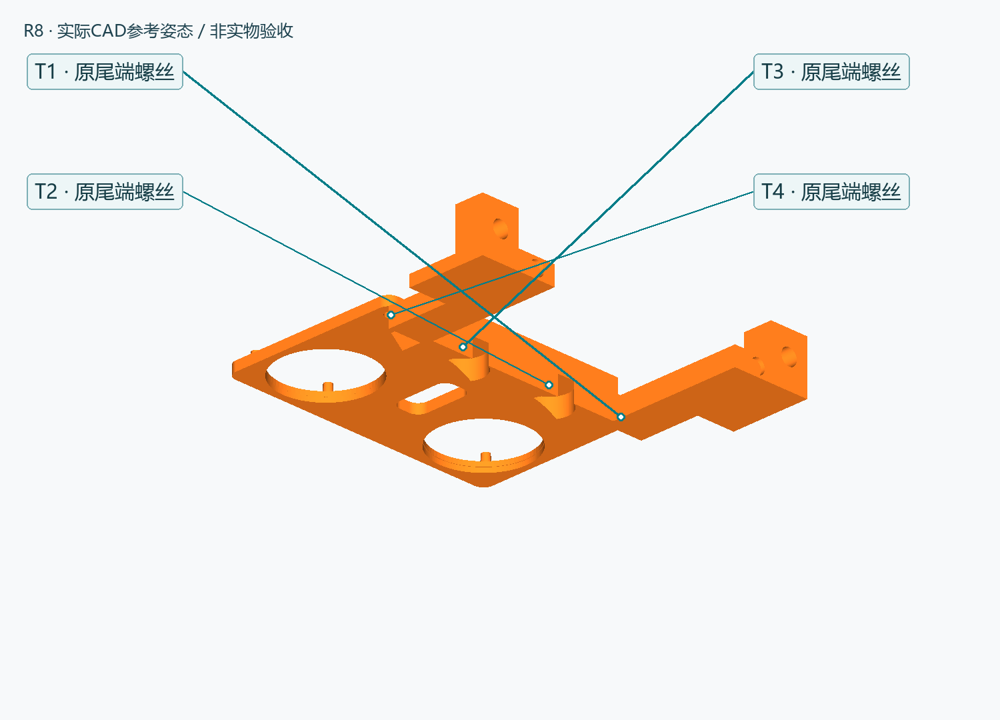
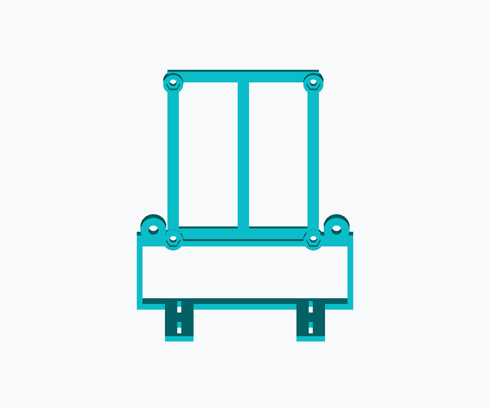
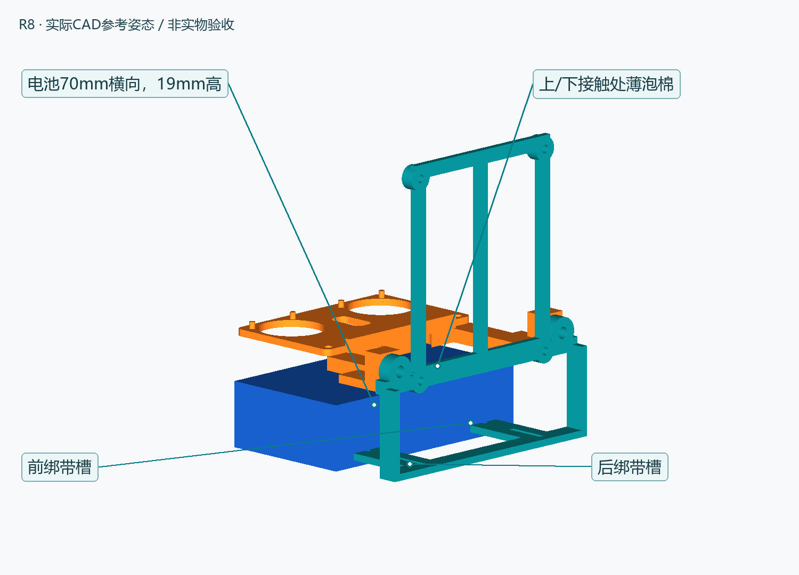
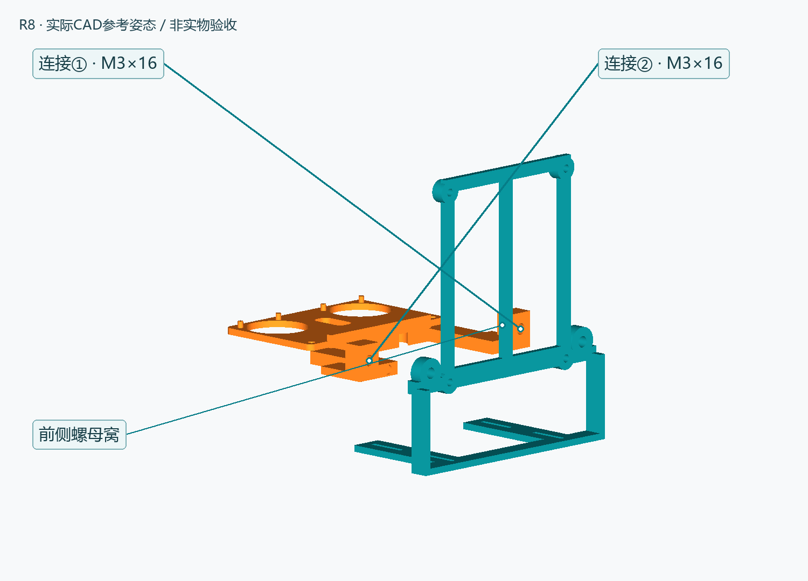
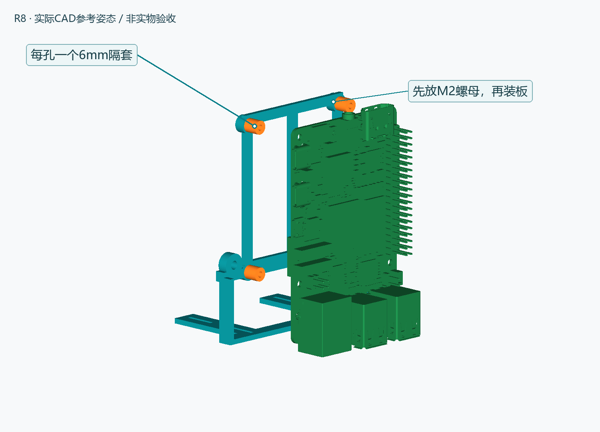
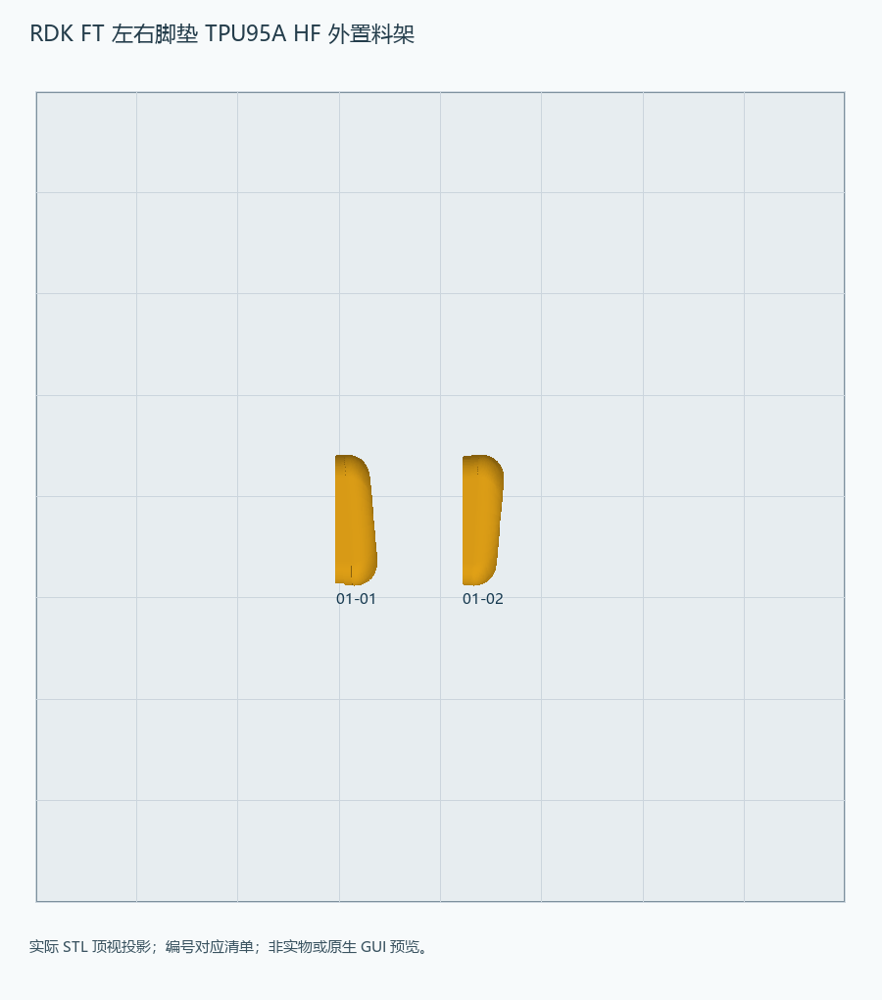

# 从FT本体到机载X5：打印与装配

本页采用 **FT本体 + R8A系列X5支架 + 实拍中的两侧电池/微雪固定 + TPU脚垫**。当前实物见[硬件页正侧照片](HARDWARE.md#2-当前实物布局)，前下方还有棕色附加安装/配重件。10月23日视频已经展示这条集成路线的短距离前进；原R8A电池占位与实拍已不同，本页区分结构设计与实际固定，不把CAD位置冒充成功当天的精确质量分布。

## 1. 文件下载与版本

| 内容 | 入口 | 用途 |
|---|---|---|
| FT整机源CAD、作者装配说明 | [机械行者Robo / fanhao375](https://github.com/fanhao375/microduck-replica-cad) | 选择飞特v2.0，勿混XL330件；源SolidWorks压缩包在上游Releases |
| 本项目R8A下部打印件 | [文件与打印清单](mechanical/README.md) | 3种零件、6个实体；可编辑BRep FCStd、STEP和STL |
| R8A整盘打印工程 | [一盘六件PLA项目](mechanical/print_projects/R8A_SIX_PARTS_P1S_PLA.3mf) | 含修正后的下方螺母槽，打开后重新切片 |
| 左右TPU脚垫 | [脚垫STL](mechanical/tpu_soles)、[两件一盘工程](mechanical/print_projects/RDK_FT_LEFT_RIGHT_SOLES_P1S_TPU95AHF.3mf) | 保持原FT脚垫几何，只改变材料与打印朝向 |

本机FT参考固定提交为 `22ecf4daea158f2dfad7b633f730a5c04f1e04e0`。上游原五盘有52个对象及互斥备选，不等于每个对象都需装到一台鸭子；作者图解与实际FT零件以接口核对，不把v1 XL330图片当成FT舵盘剖面图。上游整机源文件通过官方仓库获取，本仓库提供与X5集成相关的增量件。

## 2. 打印材料与零件数量

| 部件 | 数量 | 材料 / 工艺基线 |
|---|---:|---|
| L1短根座 | 1 | PLA；0.2mm，6墙、50% gyroid，热床树支撑 |
| L2平电池托指＋竖X5架（R8A） | 1 | PLA；0.2mm，3墙、15% gyroid，允许模型面树支撑 |
| S1 6mm隔套 | 4 | PLA；0.2mm，3墙、100%，无支撑 |
| 046左脚垫、048右脚垫 | 各1 | Bambu TPU 95A HF；0.2mm，3墙、20% gyroid，普通紧贴支撑 |

公开3MF是 **Bambu P1S、0.4mm喷嘴、纹理PEI** 的可编辑项目，不含直接发送的G-code；切片前核对本机和耗材。PLA与TPU分盘。TPU 95A HF使用外置料架，不能映射成PLA或TPU for AMS。其他打印机需要重设机器与材料，不直接发送P1S配置。

L2保留中间细筋、两根托指与绑带槽，拆支撑时不要误剪。下方螺母槽在R8A已留出从上往下装入的开口；旧R8六件盘中的L2未做此修改，不应混用。几何文件以本仓库[manifest](mechanical/manifest.json)为准。

## 3. 下部支架五金

| 五金 | 数量 | 位置 |
|---|---:|---|
| M3×16螺丝、标准M3螺母、M3平垫 | 各2 | L1与L2两侧连接 |
| M2×12螺丝、标准M2六角螺母、M2平垫 | 各4 | X5四安装孔 |
| 原FT腿根舵机尾端螺钉 | 4 | 复用原对应位置固定L1；不是舵盘中心螺钉 |
| 约10mm宽、≤1mm厚细绑带 | 2 | 从托指槽穿过固定下电池；长度按实物留余量 |
| 薄泡棉与绝缘垫 | 适量 | 电池消隙、两侧模块固定、避开焊点 |

螺钉长度按头下长度计；M2螺母设计采用对边约4mm、厚约1.6mm的普通六角款。法兰、防松或加厚螺母不一定适配。PCB叠层对螺钉余长较敏感，不随意加厚垫片或换长螺钉。

## 4. 分步安装

### ① 先装FT本体并确认机械活动

依作者资料完成躯干、左右腿和头颈。记录每个舵机的物理位置与ID。先在断电状态检查各关节，区分驱动盘与非驱动侧副盘，不强掰，也不通过强拧螺丝消除错装造成的卡滞。原本体的轴承、舵盘、原螺钉沿用FT方案，不照搬其他鸭子的孔位。

### ② 换L1短根座

断开两路电源和USB，支撑好头部及躯干，卸掉旧远悬背包载荷。L1替换原对应底座，不叠在旧底板上；短梁朝鸭子后方。T1～T4是原腿根舵机尾端四个孔，保留原轴座与接口，原螺钉按原位置复用。

### ③ 离机准备L2和螺母

清理支撑、通孔、绑带槽和下方两螺母装入口。四个M2螺母先放好，再安装X5；R8A下方两颗从槽上方朝下滑入，保留底部六角定位。不要因装不进去就扩大PCB孔或把螺母强压进PLA。

L2仍保留原设计的平电池托指及绑带槽。下图是**原设计托盘的装配参考**：70mm左右、40mm前后、19mm高度，薄泡棉消隙、绑带防脱。10月23日成功照片的电池已移到机身两侧，不要照下图再额外装第三块电池，也不要将这张局部CAD图误认为当前整机布局。无论采用哪一固定位置，都不能让电源线承重。

### ④ 将L2接到L1

两侧各一套M3连接：**螺丝头 → 平垫 → L2孔座 → L1后端孔座 → M3螺母**。连接孔中心距64mm。托住电池/支架组件再锁紧，不通过拧紧让错位零件强行变形。图中爆炸间距仅便于识别，实装两接触面贴合。

### ⑤ X5竖装，四孔留隔套

X5长边竖起，接口/元件朝外，孔组按实际板卡对齐。叠层从外向内为 **M2×12头 → 平垫 → PCB → S1 6mm隔套 → L2孔座 → M2螺母**。四颗先全部对上再轻紧；不要压在焊点上，不用泡棉整面封住板卡。板孔名义间距约49×58mm，不能因板外形接近树莓派就套用其他孔组。

以上装配关系图沿用R8局部渲染，**实际下载与下孔螺母入口以R8A模型和第③步图为准**。图中X5模型仅用于说明叠层；公开打印CAD不包含厂家整板模型。

### ⑥ 按实拍固定两侧电池与微雪

按[当前正面照片](media/20261023/onboard-front.jpg)及[侧面照片](media/20261023/onboard-side.jpg)，两块电池分布在固定躯干两侧，微雪板以绝缘泡棉固定在一块电池外侧。先干装确认头颈和腿根活动空间、插头方向和电源开关可触达。胶点避开板底器件、焊针与热源；不把电池绑在活动颈部或腿部。侧面固定没有新增专用打印件，需根据实际壳体接触面和电池外形做好防滑、防剥离与防脱。

成功照片前下方还有棕色附加安装/配重件，此处如实保留该事实；尺寸、材料、质量未独立记录，不能声称已获得不带配重的同条件结果，也不能按照片猜一个统一克数。复刻时记录自己附加件的重量和位置，再用控制台逐轮调整。不要混用旧重型远悬背板、顶部电池占位图和当前两侧安装照片。

### ⑦ 装TPU脚垫并收线

保留原硬脚掌、脚踝、舵机，只更换脚底套。清掉裙边和凹槽中的支撑，再分别装046左和048右；这两个是打印件编号，与舵机ID无关。薄包边不要用大力拉扯；检查贴合、两脚触地和防脱。

两电池分别就近供板卡，信号线沿固定躯干收束，腿间不留易勾住的大线圈。给髋、膝、颈和插头留活动余量；IMU保持固定和原朝向。[完整接线](HARDWARE.md#3-两路电源与信号连接)。

### ⑧ 建立本机站姿，再逐步验证

检查根座无裂纹、螺母已坐实、电池不滑移、线缆不拉扯；托住本体逐步承载附件。新机先核每轴ID/方向与本机START，再悬空检查小动作，最后有人接护试站与单轮短步。更换TPU、载荷或安装位置后需要重新观察，不能把程序“回START”直接当成现场已站稳。动作与参数流程见[部署说明](DEPLOYMENT.md)。

## 5. 我们遇到过的装配问题

- **大腿托架定位柱偏短**：本批曾出现只到孔口、不能有效插入的情况。做过柱端加长1.5mm候选，但用户最终优先保留原结构固定方式。不能把候选改件作为所有复刻机必改；定位柱也不是有螺纹的紧固件。
- **舵盘与脚踝叠层干涉**：先核对需要保留的驱动盘及应拆的副盘，不直接缩薄承力件。更长螺钉需检查盲孔余深，不能盲拧。
- **孔对上但螺母进不去**：R8A专门增加下部两颗M2螺母的装入通道，装配顺序改为螺母先入位。最终位置有空间，不等于工具和螺母有装入路径。
- **旧背包远离本体、连接处断裂**：因此收近下部电池和X5，缩短悬臂，取消大背板；结构位置和质量分布一起处理。局部CAD检查不等于PLA强度认证。
- **工程图视角混乱**：左右始终按鸭子自身；爆炸图分离距离不是实装间距。只使用同版FT接口和本页R8A文件。

## 来源与文件许可

FT结构由机械行者Robo建模、fanhao375整理，源于Pollen MicroDuck生态。包含FT接口的R8A底座、相关衍生CAD/STL和脚垫依 [CC BY-NC-SA 4.0](https://creativecommons.org/licenses/by-nc-sa/4.0/) 保留署名、非商业、相同方式共享；详见[机械文件说明](mechanical/README.md)。源码许可和媒体许可分别见[NOTICE](NOTICE.md)。
