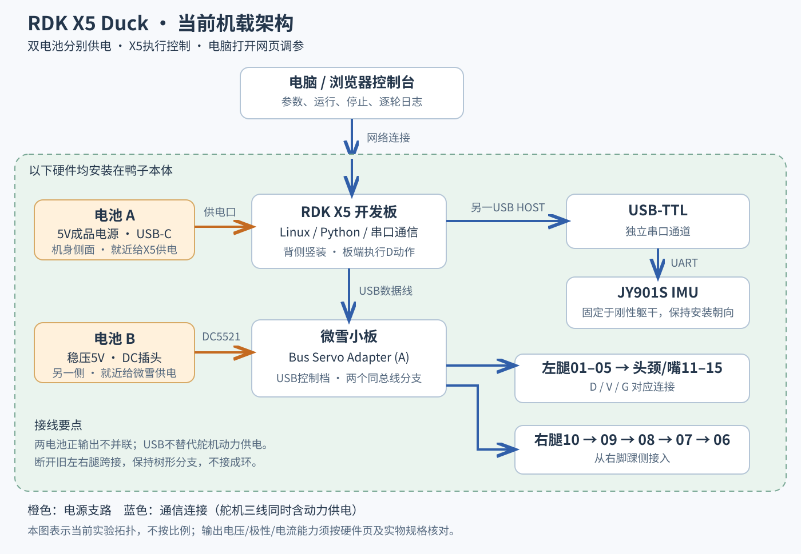
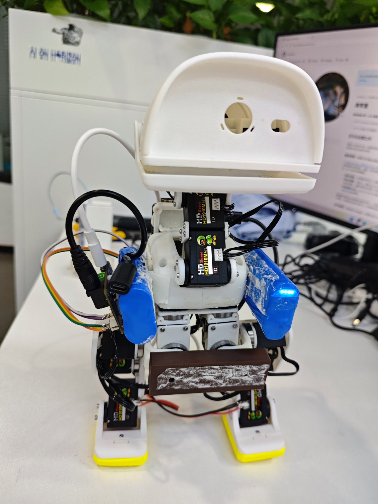
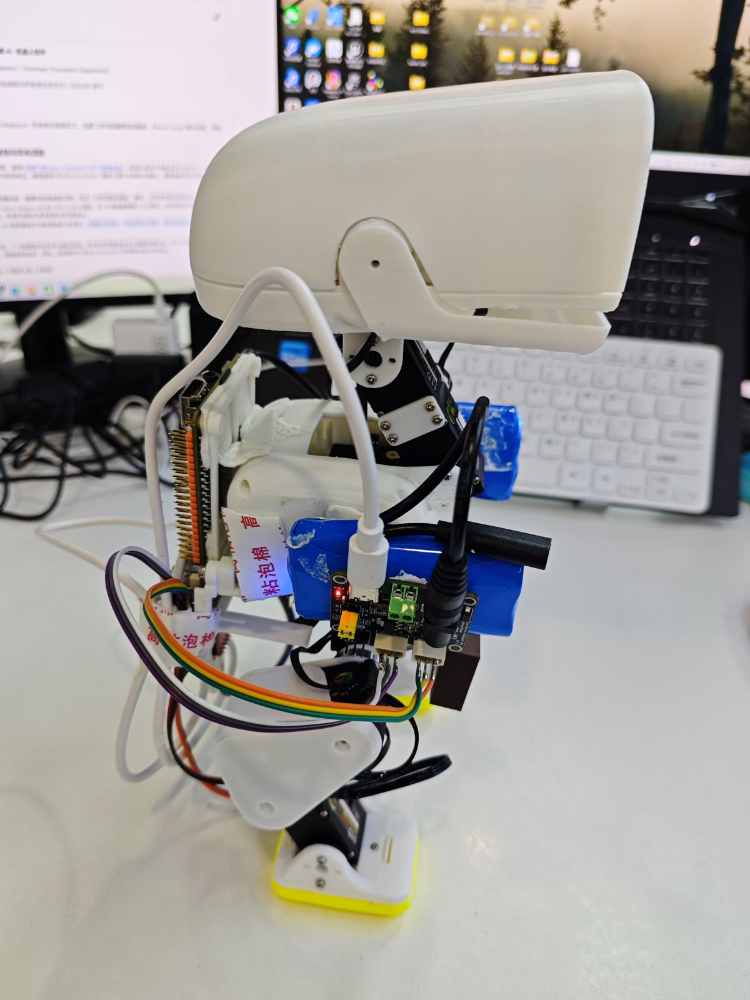
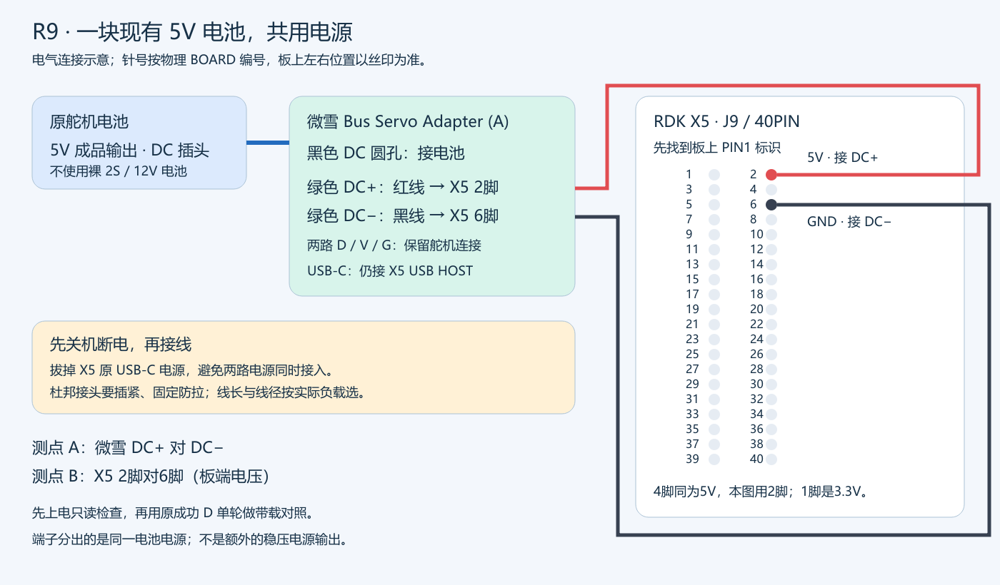

# 硬件、供电与关节映射

> **最新进度｜2026-10-30：** 当前单5V电池样机已能正常供电、启动和站立，带载行走出现供电不足表现。已采购2S 1000mAh 45C电池、好盈5A UBEC（5.0V供X5）、分线/转接线及S10充电器，预计11月2～8日到货验证。[完整采购清单、新接线与后续安排](progress/2026-10-30/README.md)。下文10月27日电源说明保留为历史；旧DC端子直供X5的接法禁止用于新2S电池，新方案尚未验收。

## 当前单电源样机

[](docs/CURRENT_PROTOTYPE.md)

当前实装为**背部竖放X5、其后方框架内单块电池、上部微雪小板、网口附近IMU**；通信已改用40PIN两路UART。正背面照片、供电升级和待验证事项见[当前样机](docs/CURRENT_PROTOTYPE.md)。

**下面第0～5节保留10月23日双电池成功配置的复刻基线；其USB线和第二块电池属于历史配置，不能当作当前单电源布局。** 新2S供电使用独立5.0V UBEC支路给X5，接线方案见[10月30日进度](progress/2026-10-30/README.md)。

本页回答三个问题：每块硬件承担什么功能、线应接到哪里、软件用什么配置访问它。实际下单看[可采购BOM与打印清单](docs/PROCUREMENT.md)，组装看[装配教程](ASSEMBLY.md)，成功当天的装载与未知测量集中在[样机配置卡](docs/PROTOTYPE_CONFIGURATION.md)。新搭建者可按[逐步交付表](docs/BUILD_CHECKLIST.md)执行。

**2026-10-27更新：单电池经微雪DC+/DC−分供，X5和15个舵机已能正常供电、启动。** 具体接线与后续带载验证见[第6节](#6-2026-10-27单电池供电启动更新)和[单电池/R9专章](docs/SINGLE_POWER_R9.md)。

下文原基线对应 **2026-10-23 全机载短距离前进展示、2026-10-26方案发布**。RDK X5、微雪 Bus Servo Adapter (A) 和两块电池均随鸭子运动。电脑用于打开控制台和调参，板端执行控制；本次成功动作不依赖实时运行完整 RL 策略，也没有用 NPU 加速这段动作。



## 0. 硬件职责与接口边界

| 层级 | 设备 | 输入 | 输出 / 作用 |
|---|---|---|---|
| 操作端 | 电脑浏览器 | 用户参数、运行/停止、观察结果 | 经SSH转发访问X5本机HTTP服务；不直接接舵机 |
| 主机 | RDK X5 | 参数、IMU与舵机读回 | 执行动作时序，计算11号颈部目标，发送串口包并写日志 |
| 总线适配 | 微雪Bus Servo Adapter (A) | USB数据、独立舵机电源 | USB转舵机TTL半双工总线；两口是同一总线的分支 |
| 姿态感知 | JY901S＋独立USB-TTL | 机身运动、传感器供电 | 欧拉角与角速度串口帧；传感器安装方向在配置中说明 |
| 执行端 | HD1910M×15 | 关节位置目标与动力电源 | 执行关节动作，读回位置、电压、温度、状态等 |
| 结构与接触 | FT打印本体、轴承、R8A、TPU脚底 | 关节驱动力和载荷 | 确定轴线、运动范围、质量分布及与地面的接触 |

微雪板不运行步态，不是15路PWM舵机控制器，也不负责把任意电池电压降为5V。X5经USB下发总线协议，舵机内部执行其自身位置控制。公开D运行包不需要ROS、CUDA、ONNX或NPU推理；仿真和RL研究由[仿真环境](SIMULATION.md)另行说明，不改变这条实机信号链。

## 1. 双电池成功基线硬件清单（10月23日）

| 部件 | 数量 | 本台配置 / 选择依据 |
|---|---:|---|
| RDK X5 开发板 | 1 | 完整开发板，非 X5 Module；背侧竖装，接口朝外，安装尺寸依据本项目 R8A 文件 |
| microSD 卡 | 1 | 安装与板卡对应的 RDK 系统；容量依镜像及日志需求选取 |
| 飞特 HD1910M 总线舵机 | 15 | FT 结构版本；左右腿各5只、颈头4只、嘴部1只。不能用外形近似的其他型号替换后直接套配置 |
| 微雪 Bus Servo Adapter (A) | 1 | 42 × 33 mm，小板型号要带 `(A)`；通过 USB 接 X5，选择 USB 控制档 |
| JY901S IMU | 1 | 固定在躯干刚性区域；通过独立 USB-TTL 与 X5 连接 |
| USB-TTL 模块 | 1 | 与 IMU 的串口电平和供电要求匹配；TX/RX/GND按模块标注连接 |
| 舵机电池 | 1 | 本台使用成品稳压5V小电池，历史购买规格为5V/0–3A、2400mAh；DC插头接微雪。输出能力不是15只舵机全工况供电保证 |
| X5 电池 | 1 | 与上项相近外形、USB-C输出的成品5V电源；成功实拍中两电池分置机身两侧，本台配置不作为所有X5负载的推荐电源 |
| 两根电池输出线 | 2 | 原配置可弯线长约15 cm，各供对应板卡，不交叉绕远 |
| USB-A → USB-C 数据线 | 1 | X5 USB HOST → 微雪 USB-C；需要数据能力，不能用仅充电线 |
| USB线 / 串口排线 | 1套 | X5 → USB-TTL → IMU；避开腿和颈部活动范围 |
| 三线总线及连接线 | 1套 | D/V/G一一对应，两路树形分支；按现有舵机接头制作，不凭线色判断引脚 |
| FT 本体打印件与五金 | 1套 | [FT 上游 CAD 与装配资料](https://github.com/fanhao375/microduck-replica-cad)，使用飞特 v2.0 分支的配合件 |
| 下部 X5 / 电池支架 | 1套 | [R8A：L1×1、L2×1、6mm隔套×4](mechanical/README.md)，PLA |
| 左右脚垫 | 各1 | FT原形状、TPU 95A HF；黄色脚垫可见于本次实拍 |
| 泡棉、绑带与绝缘辅料 | 适量 | 两侧电池/微雪固定、支架消隙和板底绝缘；不让线缆承重 |
| 前下方棕色附加安装/配重件 | 见实拍 | 成功展示照片中仍有该附件；材料、尺寸及实际重量未独立记录，不给出虚构的通用克数 |

两块电池设计占位均为 **70 × 40 × 19 mm**，历史单块称重约84 g。购买时复核实物尺寸、输出档位、出线方向及接口；外形相同不代表电气规格相同。裸鸭本体曾称重611 g，当前完整机载版本未重新整机称重，不能将旧487 g背包或仿真估重当作本版实际重量。

打印文件现在提供[选定28件FT本体](mechanical/body_parts/README.md)，另加R8A六实体和两TPU脚底。具体轴承、螺丝、接口规格和哪些上游备选不打印，见[采购表](docs/PROCUREMENT.md)。已有短距离成功视频采用双电池；现在已完成现有5V电池从微雪DC端分供X5和舵机的启动验证，带载与连续运行继续验证。两套配置分别记录，最新路线见第6节。

## 2. 双电池历史样机布局（10月23日）

| 正面：两侧电池与前下方附件 | 侧面：贴身X5与微雪 |
|---|---|
|  |  |

- **躯干两侧**：成功实拍可见两块蓝色电池分置两侧，以泡棉等固定；微雪小板贴在其中一块外侧，板底焊点与电池外皮绝缘，接口保留插拔空间。
- **背侧**：X5保持竖装，与对应电池就近连接；支架采用R8A系列。R8A原设计含下部平电池托指，但不据此推断成功当天电池仍在下部托盘内。
- **前下方**：实拍可见棕色附加安装/配重件。其质量、材质和固定细节没有独立测量；照片不能据此给出精确质心或任意新机所需配重。
- **IMU**：固定于刚性躯干部位，保留已核对的安装朝向；不能改粘到活动头颈或松动电池上。
- 旧版“两个电池都远悬在背后”、R8原始CAD“顶部平叠”、10月22日“胸前电池+下部电池”均是过程方案。公开R8A CAD只保留打印件，本节历史样机以10月23日实拍为准；当前单电源实装见页首入口。

## 3. 双电池历史基线的电源与信号连接

```text
电池A（5V、USB-C） ─────────────→ X5电源USB-C
X5 USB HOST ── USB数据线 ───────→ 微雪USB-C（USB控制档）
电池B（稳压5V、DC插头） ────────→ 微雪DC5521电源口

微雪总线口1 → 左腿01～05 → 头颈/嘴11～15
微雪总线口2 → 右脚踝10 → 09 → 08 → 07 → 06

X5另一个USB HOST → USB-TTL → JY901S IMU
```

两只总线口是**同一总线的分支**。不保留旧左右腿跨接形成环路；USB不是舵机动力电源。这一双电池基线中，两块电池的正输出不并联，两路供电通过USB信号地关联，不能称为电气隔离。当前单电池方案移除X5原电池，通过微雪DC端分供X5的40PIN，已完成启动验证，具体针位与适用条件见第6节。

微雪接口 D/V/G 分别为信号、正电源、地；电源输入需要匹配舵机本身。小板没有把任意输入转换为5V的稳压功能，因此不能照抄板上ST系列电压字样给HD1910M供电。USB控制时按厂商说明选择 **B / USB** 档。DC口名义尺寸是 **5.5 × 2.1 mm**；即使卖家称兼容，也要核对实物极性和接触稳定性，不能只看“插得进去”。[微雪接线说明](https://docs.waveshare.com/Bus_Servo_Adapter_A/Product-Wiring-Example)、[接口与电源FAQ](https://docs.waveshare.com/Bus_Servo_Adapter_A/FAQ)。

### IMU接线逐项核对

| USB-TTL端 | JY901S端 | 说明 |
|---|---|---|
| RX | TX | 主机接收传感器数据，运行时必须有这根 |
| TX | RX | 厂商工具配置传感器时使用；本公开运行器不写传感器配置 |
| GND | GND | 共同信号参考 |
| 对应VCC输出 | VCC | 按所购模块供电要求选；VCC供电选择与TX/RX逻辑电平是两个问题 |

串口应是TTL接口，不能使用RS232电压接口。先辨认板上丝印，不按排线颜色猜。普通USB-TTL用于IMU，微雪用于舵机，两者不是同一个串口。模块具体供电/电平以所购JY901S资料为准；厂家协议参考：[WITMOTION SDK](https://wit-motion.gitbook.io/witmotion-sdk/wit-standard-protocol/sdk/python_sdk-quick-start)。

### 从未上电整机开始的检查顺序

1. 断电核对两路电源的电压、极性、连接器及线缆承载；板底焊点与电池/金属件隔开。
2. 先让X5正常启动，确认网络和USB设备可识别，记录所用系统版本。此时不要求让15只舵机一起动作。
3. 识别IMU端口，设置所需帧类型和输出率，固定安装后核对方向。
4. 首次舵机编号按工具流程逐只完成；多只出厂同ID舵机不要同时当作“15个已识别关节”。
5. 断电完成两分支接线；上电后做15轴只读检查，确认没有漏ID或重复ID，再进入本机START流程。

对应软件命令和预期输出见[部署教程](DEPLOYMENT.md)。上电、只读、使能和运行是不同操作，不把USB被识别当成舵机已经回复。

RDK官方建议从电源USB-C使用 **5V/5A** 电源。本台轻负载电池实验已取得短距离前进结果，但这不等于较低额定电源覆盖全部算力、外设或低电量工况；复刻初期可先用符合官方要求的外置电源完成联调，再验证自己的机载电源。[RDK X5硬件说明](https://d-robotics.github.io/rdk_x_doc/en/Quick_start/hardware_introduction/rdk_x5/)。本次保持双电池方案，不指定未经本台验证的升压改造。

## 4. 15个舵机ID与已观察方向

“左/右”均指鸭子自身。方向列是本台实测的**原始计数增加方向**，不是模型关节正方向；4096计数约一圈。原始模式、硬件零偏、机械安装和START需要分别记录。

| ID | 物理关节 | 原始计数增加时的已观察方向 |
|---|---|---|
|01|左腿根偏航|左脚尖向外|
|02|左髋侧摆|左脚向内|
|03|左髋俯仰 / 大腿上端|大腿向嘴巴方向|
|04|左膝|小腿向身后|
|05|左脚踝|脚尖抬起|
|06|右腿根偏航|右脚尖向内|
|07|右髋侧摆|右脚向外|
|08|右髋俯仰 / 大腿上端|大腿向屁股方向|
|09|右膝|小腿向前|
|10|右脚踝|脚尖下压|
|11|颈根俯仰|脖子连头向后|
|12|头部俯仰|嘴尖低下|
|13|头部偏航|嘴巴朝自身右侧|
|14|头部横滚|头顶朝自身右侧|
|15|嘴部|闭合方向|

03和08已在10月22日悬空逐轴重新观察确认。复刻机必须自己核对ID与方向，不因左右外观镜像就假定计数符号相反。公开动作通过每机配置接入，不将本台历史绝对计数强制写入别台机器人。

## 5. IMU与初始站姿

机体坐标约定：+X朝嘴巴，+Y朝鸭子左侧，+Z向上。记录IMU安装旋转、串口、波特率及输出格式。模块贴在同一位置不代表方向相同；换支架或泡棉后需重新核对俯仰/横滚读数方向。泡棉不能使模块相对机身明显晃动。

本台D成功配置的自动前后倾反馈增益均为0，主要使用**分段颈角与提前收颈**配合已有腿部动作。IMU接入与记录已实现，不将本次成功视频描述为IMU全身自平衡或完整RL闭环验收。

初始站姿由用户摆放、检查并读回保存。断电再上电后，先托稳并读状态，再缓慢复位；本仓库历史样例位置只用于审阅。新机的动作入口与配置步骤见[部署说明](DEPLOYMENT.md)，打印和实际装配见[装配说明](ASSEMBLY.md)。

## 6. 2026-10-27单电池供电启动更新

现场已确认：复用现有成品5V舵机电池，经微雪绿色DC+/DC−分供后，X5和15个舵机均能正常供电、启动。接线为电池→微雪黑DC5521；绿色DC+→X5 J9物理2脚5V、DC−→物理6脚GND，X5原USB-C电源移除，USB HOST→微雪数据线保留。物理4脚同为5V，1脚是3.3V；按板上PIN1标记识别，不能混用GPIO号。



本方案暂不增加降压/稳压模块。绿色端子分出的是已有5V电源，不是独立稳压输出或新增电流额度；小板内部逻辑电源与舵机动力支路分开理解。现有电池历史额定0～3A，X5与舵机共享总输出，板端压降、负载峰值、接头和线径需按实际工况检查。

本次确认范围为供电启动，尚未确认单电池带载行走、连续运行、动态电压、温升及续航。来源与状态见[进度记录](progress/2026-10-27/README.md)；接线细节、R9机械方向及后续步骤见[单电池与R9](docs/SINGLE_POWER_R9.md)。10月23日照片和行走视频不改为单电池证据。
