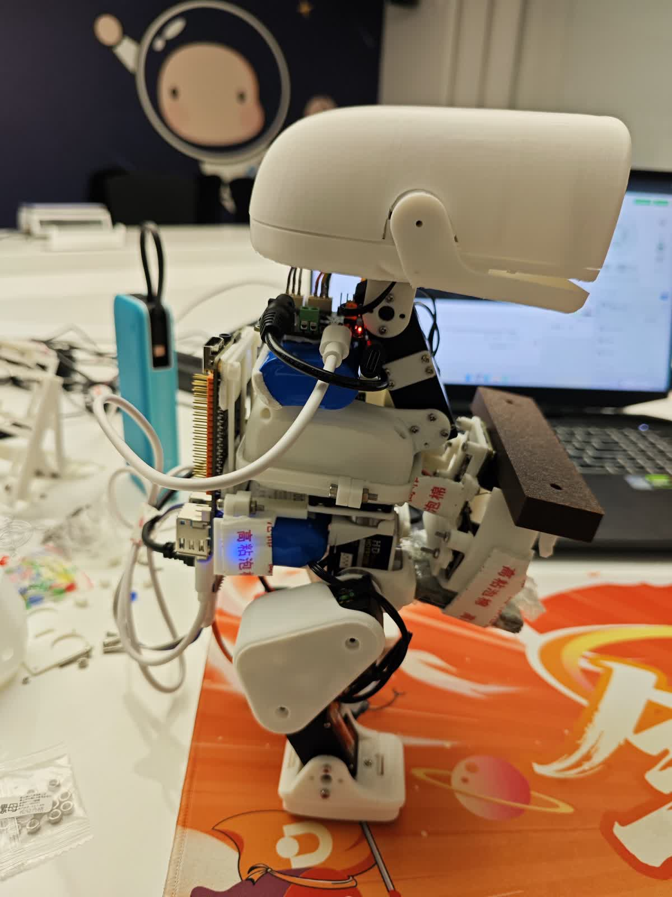
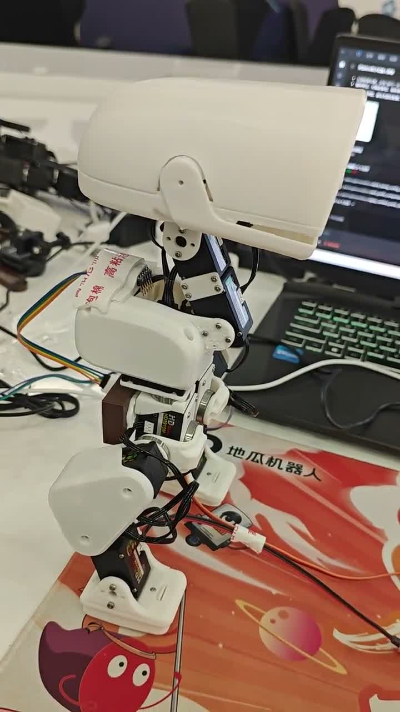

# RDK X5 MicroDuck｜全套硬件上身，实现短距离前进

## 突破性进展 · 2026-10-23

**RDK X5、微雪 Bus Servo Adapter (A) 和电池全部安装到鸭子本体后，已实现平面上的短距离前进，并在本次展示结束时保持站立。**

这是从此前“桌面外接电控能够短步前移”，到“机体携带计算、驱动和供电后能够前进”的关键跨越。我们围绕结构布局、负载、实际关节跟随，以及起步—走动—收步的衔接持续迭代，最终由现场微调得到本次演示配置，并已冻结为控制台默认。

[▶ 最新完整实拍（约13秒）](media/20261023/onboard-short-walk.mp4) · [本次进展、参数与新增控制源码](progress/2026-10-23/README.md) · [地瓜社区连续记录](https://forum.d-robotics.cc/t/topic/35728)

视频前段展示短距离前进，后段环绕展示上身硬件；不是连续行走13秒。当前成果是这台机载原型的短距离功能突破，后续继续优化起停重复性和更长距离稳定性。

| 正面：机载供电与驱动 | 侧面：X5与贴身安装布局 |
|---|---|
|  |  |

本次使用 **D历史目标片段＋11号颈根分段定角与提前收颈**：启动0°、走动请求前移30°、保持0秒、过渡0.2秒、提前收颈1.1秒，自动前后倾反馈均为0。它不是陆吾实时策略，也不是本次视频已验证全身RL闭环行走；[参数的时间与角度定义](progress/2026-10-23/README.md#控制方式与冻结配置)已说明。

### 一条主线，两条副线

- **RDK X5 Duck主线**：聚焦实机集成与行走，本次完成全套硬件上身后的短距离前进。
- **陆吾 XGO-Duck副线**：独立的Arduino UNO Q平台已完成15轴标定、站立与短程前进验证，为装配和控制链路提供对照，不套用其零位或把成果算到RDK上。
- **南瓜鸭副线**：推进主题打印装配、互动机构和数字瓜园；网页、Godot、MuJoCo及UE5可玩版已有阶段交付，实物装配与互动联调继续推进，仿真结果与实机成果分开记录。

后续以RDK主线的起停、重复性与结构轻量化为重点；V2继续与硬件同事协作推进**机内集成电控与电源**，不是继续增加外挂背包。[完整后续路线](ROADMAP.md)

---

## 历史研发进度 · 2026-10-19

目前已将 RDK X5、微雪舵机小板和电池全部外挂安装到鸭子本体，整机能够正常站立。当前主要在优化结构布局、减轻配重和整机负载，带载行走调试仍在推进。

这是常规研发进度记录；此前桌面外接方案的短距离行走演示，不代表当前机载配置已完成行走验证。



[▶ 近期实机记录视频（2026-10-15，完整约17.5秒）](backpack-progress-20261015.mp4) · [地瓜社区连续记录](https://forum.d-robotics.cc/t/topic/35728)

以下保留 **2026-09-29 桌面外接方案**的历史记录与工程资料。

**2026-09-29 阶段成果：完成整机装配、RDK X5 控制链路打通，以及平面上的短距离行走演示。**

这是基于 MicroDuck 开源生态、使用飞特 HD1910M 舵机的实体原型实践。仓库公开本阶段的实现代码、微调工具、装配与调试经验、成功演示和失败案例，方便社区复现与继续改进。

> 本阶段是受控环境下的功能演示。行走稳定性、负载集成和更长距离运动仍在优化，不是成熟产品或任意机器可直接套用的步态。当前没有完成专用 HD1910M 策略重新训练。

## 先看实机

[▶ 最新阶段演示（完整约20秒）](milestone-20260929.mp4)

视频**前段展示数秒短步前移，后段展示微雪小板、RDK X5 与整套连接方案**；并不是连续行走20秒。保留原始动作与完整拍摄顺序，仅做发布压缩和定位等元数据清理。



- [早期案例：走动中前倾、需要手接护](pitfall-loaded-tracking.mp4)
- [早期案例：前段小动作与后段幅度突变](pitfall-policy-transition.mp4)
- [两段视频对应的工程复盘](PITFALLS.md)

## 本阶段交付

| 内容 | 当前进展 |
|---|---|
| FT 打印结构及15个舵机 | 完成整机装配、编号、方向检查与站姿记录 |
| X5 → USB → 微雪 Bus Servo Adapter (A) | 完成舵机读写、站姿恢复与动作演示 |
| JY901S → USB-TTL → X5 | 接入姿态/角速度，完成机体坐标转换候选与数据记录 |
| 原版策略与实机适配 | 完成仿真对照、X5 CPU 推理、目标与实际位置跟随检查 |
| 短距离行走演示 | 已取得阶段性结果，后续继续改善稳定性 |
| 本地微调台 | 参数可调、单次运行、停止、托稳复位、配重备注和逐轮记录 |

9月29日视频中的 X5、小板和电源放在桌面，通过线缆连接。不能将该历史视频描述为板卡已全部上身、无线自主行走或完成长期可靠性验收；当前机载配置进度见页首更新。

## 文档导航

1. [完整推进过程与时间线](BUILD_LOG.md)
2. [打印、装配、舵盘、定位柱和螺丝踩坑](ASSEMBLY.md)
3. [硬件链路、15关节编号与坐标约定](HARDWARE.md)
4. [行走、IMU、目标跟随与对照实验复盘](PITFALLS.md)
5. [代码、微调台和复用边界](DEPLOYMENT.md)
6. [下一阶段背包方案与第二版计划](ROADMAP.md)
7. [项目贡献与上游致谢](CONTRIBUTIONS.md) · [来源与许可](NOTICE.md)

## 2026-09-29历史微调参数与控制方式

最新一次面板记录：颈根补偿增益 `0.375`，最大后倾 `4°`，死区 `1°`，仅对 **11号颈根**增加实时相对俯仰补偿。详细记录见 [参数](milestone_parameters.json) 与 [抽样遥测](milestone_telemetry.json)。

此次演示使用**已记录的舵机目标序列 + 11号实时补偿 + 缓回站姿**，不是每拍在线运行完整强化学习策略，也不是把实测关节位置再次当目标。源序列来自先前策略实验的实际下发目标，面板单轮不切入后段大动作，不自动循环。

配重位置、姿态、地面与线缆都会影响效果。这些参数属于本台原型的一次阶段记录，不是所有 FT 机器鸭的通用推荐值。界面的配重选项是人工备注，不能代替实物称量或照片。

## 开源代码

- [完整整理源码 ZIP](microduck-source-20260929.zip)：保留目录结构，含微调台前后端、板端桥接、IMU解析、策略映射、有限轨迹、跟随检查和复位等26个本项目控制模块，另附上游总线模块与来源说明。
- 根目录直接可读：`neck_prefix_compensation_20260929.py`、`duck_tuning_config_20260929.py`、`imu_trace_20260927.py`。
- `source_manifest.json`（ZIP内）记录本地原版本与公开脱敏版哈希；[发布文件校验](SHA256SUMS.json)。

在不连接机器人时，可先解压 ZIP：

```sh
python -m unittest test_public -v
python offline_check.py
python duck_tuning_panel/server.py --demo --port 9184
```

随后浏览器打开 `http://127.0.0.1:9184/`。公开包默认是 **DEMO**，不发送硬件动作。历史实机控制源码供适配和审阅；本机私有路径、设备序列号、SSH配置和完整内部回执没有整体公开，不能将示例站姿用于另一台机器人直接上电运动。详见部署说明。

## 项目推进与后续

在团队支持下，本阶段由 **CanNyCat（GitHub：Xiaomiju-x）主导项目推进与实机集成**，覆盖方案复用、打印装配、舵机联调、X5控制链路、IMU接入、现场调试和成果整理。上游机器人设计、CAD和强化学习框架分别属于原作者，不将这些上游成果包装成本项目原创。

接下来先将现有 X5、小板及新电源通过可拆卸打印背包集成到机体，再根据增加的负载重新核对重心和步态；X5 Module + 专用底板的第二版继续推进，但不等待定制硬件完成才开展集成验证。

## 社区与来源

- 地瓜社区项目连续记录：https://forum.d-robotics.cc/t/topic/35728
- 本项目个人仓库：https://github.com/Xiaomiju-x/rdk-x5-microduck
- Pollen Robotics Microduck：https://github.com/pollen-robotics/microduck
- 官方训练框架：https://github.com/pollen-robotics/microduck_rl
- 机械行者Robo / fanhao375 FT CAD：https://github.com/fanhao375/microduck-replica-cad
- 复刻资料与总线参考：https://github.com/fanhao375/microduck-replica

本仓库是项目实践记录，不代表 Pollen Robotics、飞特或微雪的官方支持与性能承诺。
