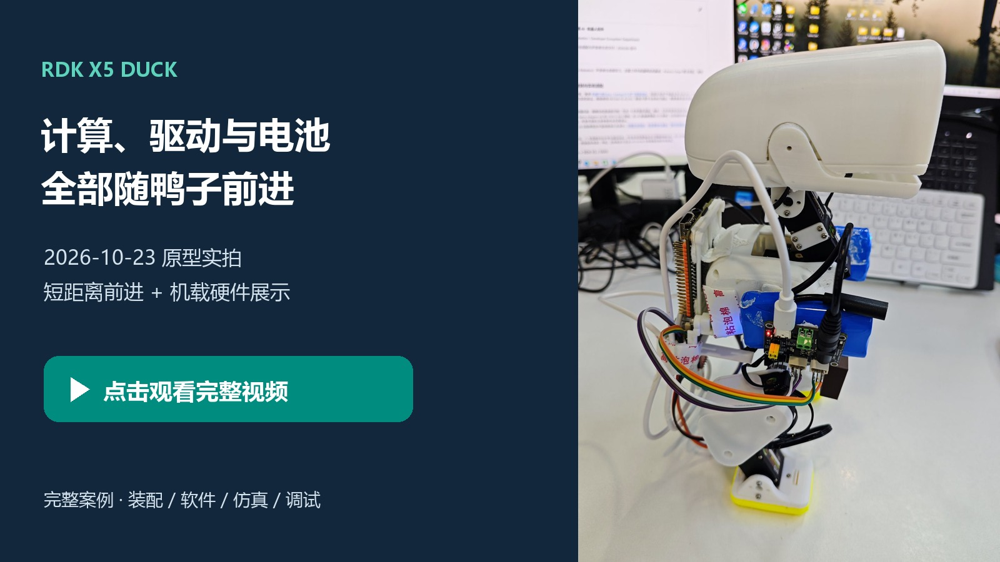
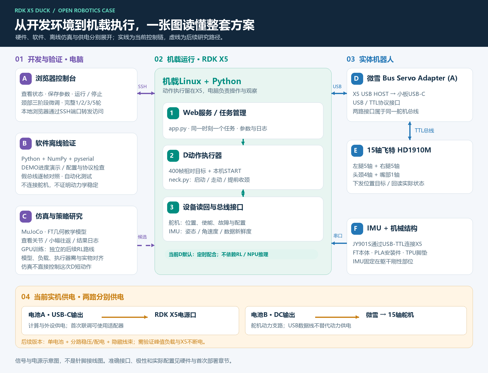

# RDK X5 Duck｜从零搭建一台机载机器鸭

**一套围绕 RDK X5 开发板展开的机器人案例：硬件采购、3D打印、装配接线、软件部署、仿真环境和实机调试，按复刻顺序完整公开。**

我们已让 RDK X5、微雪舵机小板与电池全部随鸭子运动，实现平整地面上的短距离前进。下面的实拍记录前段动作和后段机载硬件展示。

[](media/20261023/onboard-short-walk.mp4)

**[阅读完整案例](docs/FULL_SOLUTION.md) · [下载固定版本 v2026.10.27](https://github.com/Xiaomiju-x/rdk-x5-microduck/releases/tag/v2026.10.27) · [地瓜社区主帖](https://forum.d-robotics.cc/t/topic/35728/1)**

## 选一个入口开始

| 你想做什么 | 从这里开始 | 你会得到什么 |
|---|---|---|
| 先看方案与成果 | [完整案例](docs/FULL_SOLUTION.md) / [成功原型配置卡](docs/PROTOTYPE_CONFIGURATION.md) | 看懂系统架构、实际装载、成果与后续路线 |
| 没有硬件，先体验 | [软件DEMO](DEPLOYMENT.md) / [MuJoCo仿真](SIMULATION.md) | 控制台流程体验、FT模型与小幅关节仿真 |
| 从零购买、打印、复刻 | [采购清单](docs/PROCUREMENT.md) → [装配检查表](docs/BUILD_CHECKLIST.md) → [首次运行](docs/FIRST_RUN.md) | 从零件到自己的START与首次动作 |
| 已有FT鸭子，接入X5 | [硬件与接线](HARDWARE.md) → [部署](DEPLOYMENT.md) | 确认设备差异后接入公开D运行包 |
| 改结构、软件或策略 | [参与开发](CONTRIBUTING.md) / [后续安排](ROADMAP.md) | 有输入输出与验收目标的研究入口 |

## 完整框架



RDK X5运行机载Linux/Python程序，通过USB与微雪 Bus Servo Adapter (A)连接，控制15轴飞特HD1910M，并读取JY901S IMU。电脑浏览器通过SSH隧道访问控制台。当前成功路线使用D相对目标序列和颈部时序配合；离线MuJoCo环境提供模型观察与关节实验，RL闭环为独立推进路线。

## 五条命令体验软件

从固定Release下载并解压完整包，进入仓库根目录。使用Python 3.10或更新版本：

```sh
cd software
python -m pip install -r requirements-tested.txt
python -m unittest discover -s tests -v
python runtime.py plan --cycles 5
python app.py --demo --port 9194
```

打开 `http://127.0.0.1:9194/`，看到 `DEMO · 无硬件`。这里演示控制流程，不访问机器人。真实连接请从[首次运行教程](docs/FIRST_RUN.md)开始；需使用自己的串口、ID、模式、offset、START和IMU安装配置。

## 本版资料

| 类别 | 内容 |
|---|---|
| 硬件 | [BOM与接口](HARDWARE.md)、[采购与备件](docs/PROCUREMENT.md)、两路供电与总线分支、15轴方向表 |
| 结构 | [FT本体选定件与R8A改件](mechanical/README.md)、STEP/FCStd/STL、PLA与TPU可编辑打印工程、[详细装配](ASSEMBLY.md) |
| 软件 | [D公开运行包](software/README.md)、相对轨迹、分段颈部控制、独立IMU只读检查、[逐机部署](DEPLOYMENT.md) |
| 仿真 | [MuJoCo环境](SIMULATION.md)、FT教学模型、CPU小幅关节实验、模型来源与研究边界 |
| 实机证据 | [10月23日短距离结果](progress/2026-10-23/README.md)、完整视频/正侧照片、成功参数 |
| 复刻与共建 | [首次运行](docs/FIRST_RUN.md)、[检查表](docs/BUILD_CHECKLIST.md)、Issue模板、自动化测试、[贡献指南](CONTRIBUTING.md) |

## 当前验证状态

| 项目 | 已有结果 |
|---|---|
| 全机载短距离前进 | 10月23日原型实拍；前段前进，展示末段站立 |
| 公开D运行包 | 离线检查，1/2/3/5轮与原运行器的位置包等价；本次文档升级未代跑实机 |
| 连续2/3/5轮 | 执行完整单轮后再下一轮，软件验证完成，多轮实机效果待验证 |
| FT教学仿真 | 模型加载与小幅关节实验；不作为成功D或RL走稳证明 |
| 单电池、线束优化、长距离、RL闭环 | 按[路线与验收目标](ROADMAP.md)推进 |

成功单轮参数保持：启动0°、走动请求−30°、保持0秒、过渡0.2秒、提前收颈1.1秒、自动前/后反馈0。请求角度不等于实物实际角度，新机不能直接复用原型的绝对START。

## 社区与来源

在团队支持下，**CanNyCat（Xiaomiju-x）主导项目推进与实机集成**。RDK X5 Duck是主线，陆吾XGO-Duck和南瓜鸭分别作为平台对照与外观互动副线。欢迎通过[地瓜社区](https://forum.d-robotics.cc/t/topic/35728/1)交流，或通过[Issues](https://github.com/Xiaomiju-x/rdk-x5-microduck/issues/new/choose)提交复刻记录和改进。

项目基于[Pollen Robotics Microduck](https://github.com/pollen-robotics/microduck)、[Microduck RL](https://github.com/pollen-robotics/microduck_rl)、[机械行者Robo / fanhao375 FT CAD](https://github.com/fanhao375/microduck-replica-cad)等开源成果。新增软件Apache-2.0；机械与相应媒体按CC BY-NC-SA4.0等分类许可使用，详见[NOTICE](NOTICE.md)。

推荐复刻使用上方固定Release；`main`为开发分支。[历史研发记录](BUILD_LOG.md)、[踩坑经验](PITFALLS.md)、[9月源码归档](microduck-source-20260929.zip)保留供研究，新部署统一进入 `software/`。
