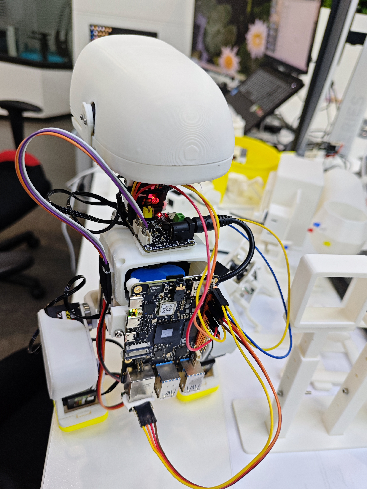
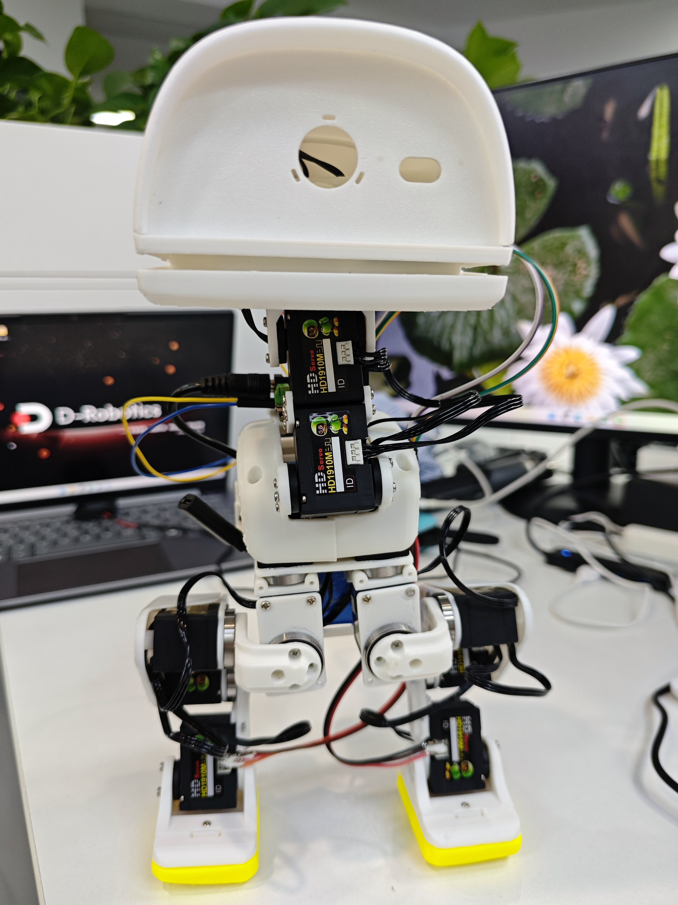

# 当前样机｜单电源机载集成

更新：2026-10-30。RDK X5 Duck 主线已从双电池机载样机继续迭代到单电源布局。

## 目前做到哪一步

- **当前单电源样机已能正常供电、启动和站立。** X5、单块电池、微雪小板均在鸭子本体上。
- **带载行走出现供电不足表现，尚未完成单电源行走验证。** 已采购2S航模电池和5V降压稳压模块，预计下周到货后做同动作对照。
- **此前双电池样机已实现机载短距离前进。** [10月23日视频、参数与实拍](../progress/2026-10-23/README.md)保留为已验证的历史成果。

## 最新实拍与模块位置

| 背面：RDK X5与竖放电池 | 正面：机体与双腿 |
|---|---|
|  |  |

| 模块 | 当前布局与作用 |
|---|---|
| RDK X5 | 背部竖装，接口朝外；运行机载控制程序、设备接入和日志记录 |
| 单块成品5V电池 | 竖放在X5后方的打印框架内，减少原两侧电池占位 |
| 微雪 Bus Servo Adapter (A) | 固定在上部躯干平台，连接舵机总线 |
| JY901S IMU | 固定在X5网口附近；沿当前安装方向使用 |
| 通信 | 已从原USB布线转为X5 40PIN两路UART分别接IMU与微雪；后续继续收拢和固定线束 |
| 结构 | 轻量打印框架与TPU脚垫；这组照片记录单电源实装，不能用旧双电池照片代替 |

## 电源升级正在推进

新方案为 **2S 1000mAh 45C航模电池分两路：一路供微雪/舵机，一路经好盈UBEC降为5.0V供X5**。电池、UBEC、分线/转接线与S10充电器已采购，预计2026年11月2日至8日到货验证，具体以物流为准。

更换2S前必须拆除旧的微雪DC端直供X5连接；2S电压不能直接进入X5的5V输入。新电源尚未实测，不能把采购完成写成供电问题已经解决。[采购与接线计划](../progress/2026-10-30/README.md)

## 接下来按这个顺序推进

新电源到货与带载对照 → 电池/UBEC固定与关节净空复查 → 收拢线束 → 复现短距离动作 → 更长距离行走 → RL实时闭环验证。

[完整24章手册](FULL_SOLUTION.md)继续保留已发布基线的复刻步骤。[固定Release v2026.10.27.1](https://github.com/Xiaomiju-x/rdk-x5-microduck/releases/tag/v2026.10.27.1)仍对应原运行与R8A制造资产；本页更新照片和进展，没有替换冻结轨迹、零位、制造文件或发布新运行版本。
