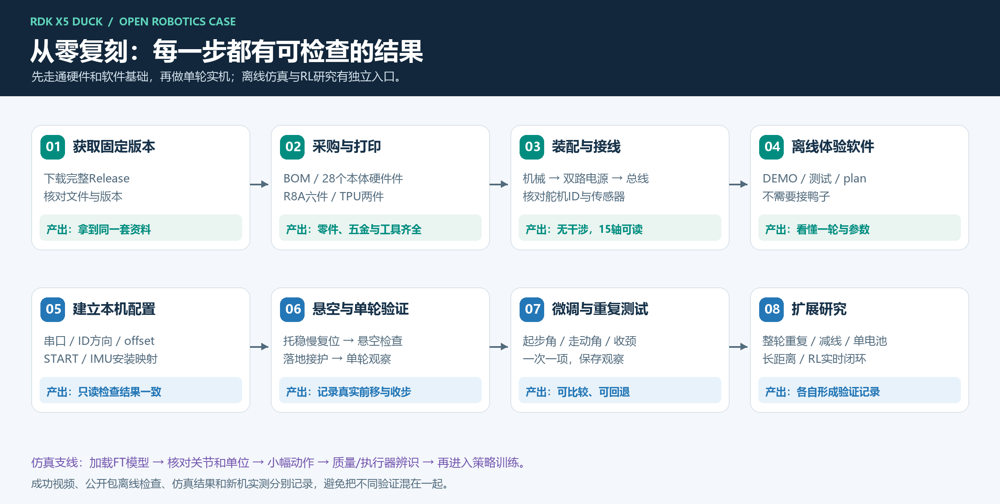
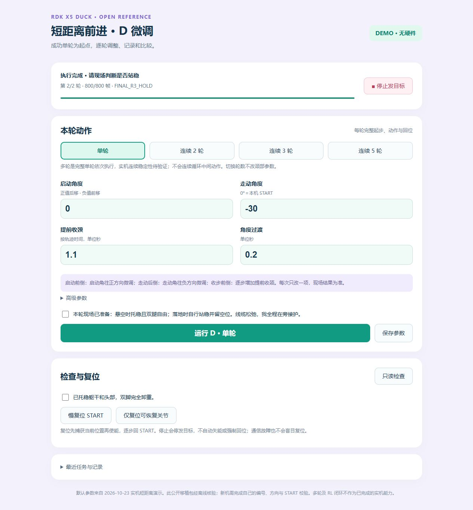
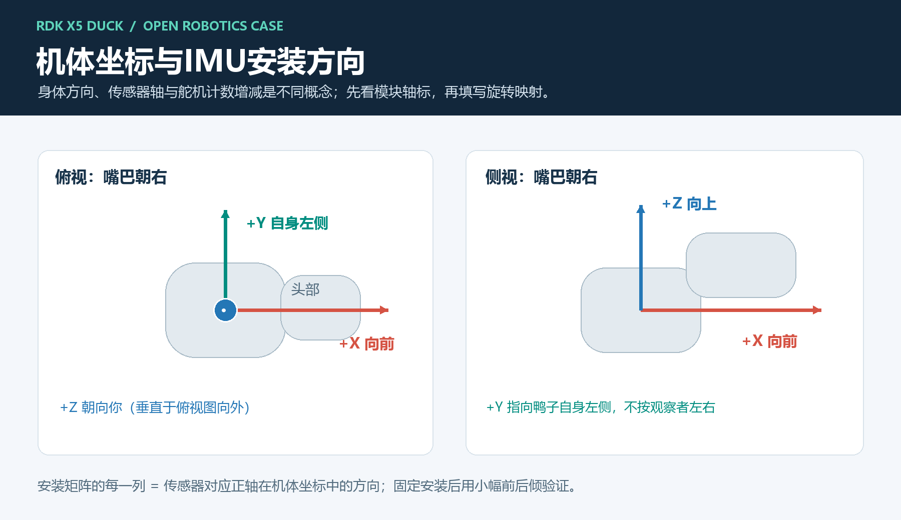
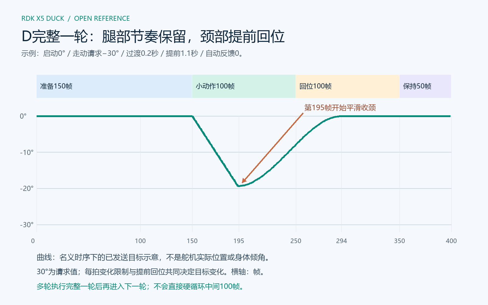
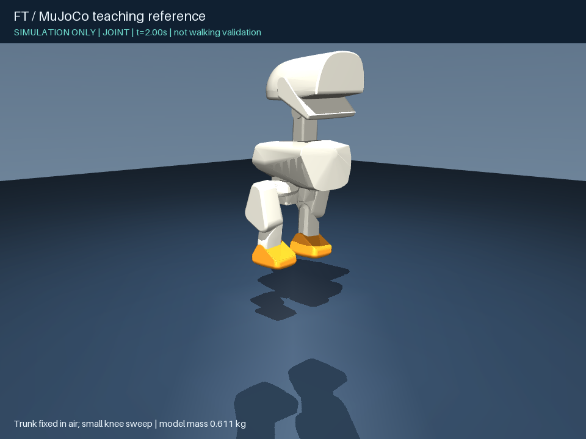
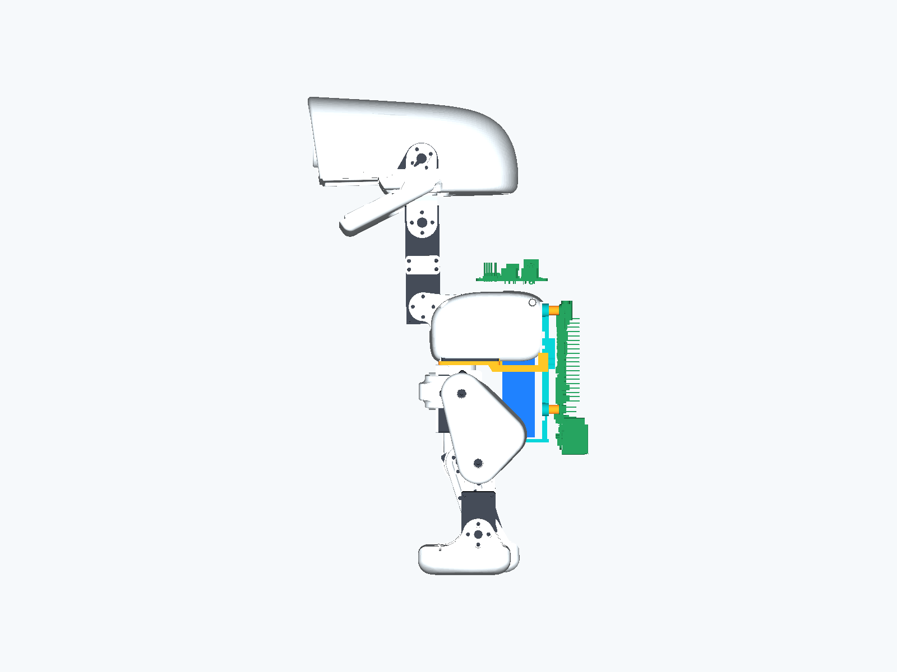
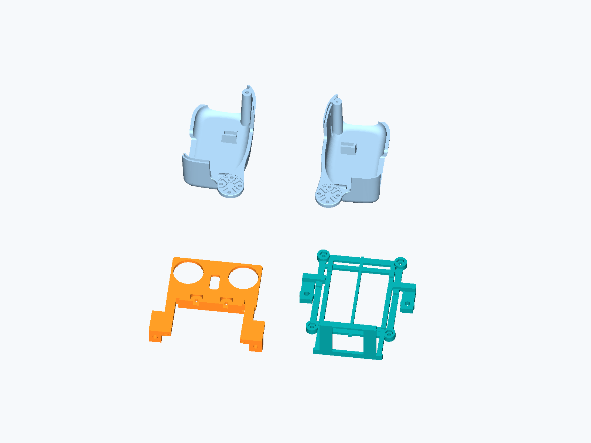

# RDK X5 Duck｜完整开源复刻手册

> **最新进度｜2026-10-30：** 当前单5V电池样机已能正常供电、启动和站立，带载行走出现供电不足表现。已采购2S 1000mAh 45C电池、好盈5A UBEC（5.0V供X5）、分线/转接线及S10充电器，预计11月2～8日到货验证。[完整采购清单、新接线与后续安排](../progress/2026-10-30/README.md)。下文10月27日电源说明保留为历史；旧DC端子直供X5的接法禁止用于新2S电池，新方案尚未验收。

**当前样机外观与进度：** [单电源正背面实拍](CURRENT_PROTOTYPE.md)，已能站立，行走供电升级中。下方标注10月27日的阅读基线与教程主体对应已发布版本；最新采购与路线以上方更新为准。

与[地瓜社区24章手册](https://forum.d-robotics.cc/t/topic/35728/1)同步更新，2026-10-27。本页为最新在线教程；固定运行与打印基线仍为v2026.10.27.1，旧tag及成功参数保持。

**把一台机器鸭从打印件装到能够机载前进，需要机械、电气、软件和动作调试共同配合。这篇文章把我们在 RDK X5 Duck 上走过的这条路，整理成可以逐章操作、逐步核对的复刻手册。**

在地瓜机器人团队的支持下，我们以现成 RDK X5 开发板为计算主机，完成了飞特舵机机器鸭的结构集成、硬件接入、机载控制和全机载短距离前进。这里既给出成果，也展开解释每个模块的作用、文件怎样选择、装配顺序、命令在哪里执行，以及遇到问题时如何定位。

> **阅读基线｜2026-10-27**
>
> 已有短距离前进实机成果采用双电池装载，配套固定下载为 **v2026.10.27.1**。目前继续研发的方向是 **复用一块现有5V电池、竖放电池、X5下移贴身、修改局部外壳和收拢线束**。最新现场实测已确认：通过微雪DC+/DC−分供后，**X5和15个舵机能够正常供电、启动**。R9结构已完成设计、切片并送印，接下来进行结构实配、单电池带载与连续运行验证，再推进更长距离和RL闭环。
>
> 因此，本手册前面的搭建步骤对应已发布基线，后面的R9专章对应下一阶段。固定版本中仍是R8A文件，不把新方案的设计图写成已经完成的行走结果。

- **GitHub项目主页：** https://github.com/Xiaomiju-x/rdk-x5-microduck
- **推荐固定版本：** https://github.com/Xiaomiju-x/rdk-x5-microduck/releases/tag/v2026.10.27.1
- **直接下载完整源码与资料ZIP：** https://github.com/Xiaomiju-x/rdk-x5-microduck/archive/refs/tags/v2026.10.27.1.zip
- **地瓜社区同步版本：** https://forum.d-robotics.cc/t/topic/35728/1

下载入口是GitHub的 **Source code (zip)**，其中包括教程、控制源码、模型、打印文件和媒体，不需要另外寻找同名自定义附件。按固定版本复刻，可以让两个人讨论的是同一组文件。

## 阅读导航：把项目分成六篇来做

不要求一天完成，也不要求先学会强化学习。每一篇结束后都应留下一份能继续使用的结果。

| 篇章 | 阅读章节 | 完成后得到什么 |
|---|---|---|
| 第一篇：先看清整套方案 | [01～03](#01先看成果这套方案已经完成什么) | 理解成果、系统职责、版本与自己的复刻路线 |
| 第二篇：买对、打对、装对 | [04～08](#04硬件与五金按模块准备一套物料) | 物料清单、已装好的机械模块与可追溯接线 |
| 第三篇：接入设备和建立本机基准 | [09～13](#09软件环境先在电脑上跑通再放到x5) | 软件环境、15轴映射、IMU方向、本机START |
| 第四篇：把单轮动作调顺 | [14～17](#14打开实机控制台先悬空再落地) | 能独立操作的控制台、调参方法、日志与复刻记录 |
| 第五篇：理解仿真与RL | [18～20](#18仿真环境在普通电脑上搭建ft模型实验) | 可运行的MuJoCo环境、载荷实验、后续闭环适配路线 |
| 第六篇：现阶段的下一步 | [21～24](#21后续主线一复用现有电池做单电源集成) | 单电池R9、机械与线束优化、长距离安排和资料索引 |

<details>
<summary>24章快捷目录：点击跳转，按自己的进度继续</summary>

- [01｜先看成果：这套方案已经完成什么](#01先看成果这套方案已经完成什么)
- [02｜系统框架：从浏览器到关节发生了什么](#02系统框架从浏览器到关节发生了什么)
- [03｜先选路线、文件和自己的记录方式](#03先选路线文件和自己的记录方式)
- [04｜硬件与五金：按模块准备一套物料](#04硬件与五金按模块准备一套物料)
- [05｜打印文件：先选件，再切片](#05打印文件先选件再切片)
- [06｜机械装配上篇：双腿、髋部和躯干](#06机械装配上篇双腿髋部和躯干)
- [07｜机械装配下篇：头颈、X5、脚底和装载](#07机械装配下篇头颈x5脚底和装载)
- [08｜电气接线：先分清动力、数据和传感器](#08电气接线先分清动力数据和传感器)
- [09｜软件环境：先在电脑上跑通，再放到X5](#09软件环境先在电脑上跑通再放到x5)
- [10｜舵机模块：编号、方向和状态要分开确认](#10舵机模块编号方向和状态要分开确认)
- [11｜串口接入：先确认自己连的是哪一个设备](#11串口接入先确认自己连的是哪一个设备)
- [12｜IMU模块：安装方向要能被解释，也要能被验证](#12imu模块安装方向要能被解释也要能被验证)
- [13｜建立自己的START，再慢复位](#13建立自己的start再慢复位)
- [14｜打开实机控制台，先悬空再落地](#14打开实机控制台先悬空再落地)
- [15｜D动作原理：为什么颈部角度和回位时机都重要](#15d动作原理为什么颈部角度和回位时机都重要)
- [16｜怎么微调：先分阶段，再每次改一项](#16怎么微调先分阶段再每次改一项)
- [17｜日志与排错：把“没走好”变成可以定位的问题](#17日志与排错把没走好变成可以定位的问题)
- [18｜仿真环境：在普通电脑上搭建FT模型实验](#18仿真环境在普通电脑上搭建ft模型实验)
- [19｜三个仿真实验：看模型、看响应、看载荷影响](#19三个仿真实验看模型看响应看载荷影响)
- [20｜从D动作走向RL闭环，需要补齐哪些工作](#20从d动作走向rl闭环需要补齐哪些工作)
- [21｜后续主线一：复用现有电池，做单电源集成](#21后续主线一复用现有电池做单电源集成)
- [22｜后续主线二：R9竖放电池、降低X5、缩短悬臂](#22后续主线二r9竖放电池降低x5缩短悬臂)
- [23｜后续实施顺序：结构、电源、线束、长距离、闭环](#23后续实施顺序结构电源线束长距离闭环)
- [24｜复刻交付清单、资料索引与参与方式](#24复刻交付清单资料索引与参与方式)

</details>

建议把本文加入书签。第一次按顺序读；遇到具体问题时，按章节号或关键词返回对应部分。命令块均标明运行设备和目录，不需要把全文命令一次性执行。

## 01｜先看成果：这套方案已经完成什么

[](../media/20261023/onboard-short-walk.mp4)

[观看完整视频：全机载短距离前进与硬件展示](../media/20261023/onboard-short-walk.mp4)

这段2026年10月23日实录展示了 **RDK X5、微雪小板和电池全部安装到鸭子本体后，机器鸭实现短距离前进，展示末段保持站立**。整段视频约13秒，前段是移动，后段是绕机展示硬件。读者可以同时看到动作结果和板卡装载关系。

这一结果的意义是，计算、驱动和供电已经随本体运动，形成可继续研发的机载原型。当前D动作使用短目标序列与分段颈部配合；长距离、复杂地面和全身RL实时平衡仍是后续工作。


成功当天的实装关系是：背侧竖装X5，两块蓝色电池分置机体两侧，微雪贴在一块电池外侧，前下方还有棕色附加安装/配重件。IMU在这组照片里被遮挡。完整整机总重、棕色件质量和若干安装距离没有完整测量，本文不会用估算值补成实测。

对新读者来说，先建立以下对应关系，就不会被仓库里的历史资料绕晕：

| 内容 | 当前依据 | 使用方式 |
|---|---|---|
| 全机载短距离前进 | 实拍、保存参数、原运行记录 | 作为复刻与后续改进的实物基线 |
| 公开D运行包 | 从成功路线整理，离线位置包等价检查 | 按自己的硬件配置接入，完成首次上机 |
| 1/2/3/5完整轮 | 功能和离线验证已完成 | 单轮调顺后逐级试，多轮距离需实测 |
| FT教学仿真 | 独立模型、运行脚本、示例输出 | 学模型、关节、载荷与环境，不需要机器人上电 |
| 单电池与R9 | 单电池已验证X5及15舵机供电启动；R9已设计、切片并送印 | 接下来实配、带载和连续运行，见21～23章 |
| 全身RL闭环 | 模型、执行器与算法适配路线 | 独立研究与验证，不替换成功D基线 |

本案例是一套持续完善的工程参考。已经公开的文件可以下载、阅读和修改；对仍缺实测的条目，我们明确写出缺什么，让后续复刻者知道自己的工作从哪里开始。

## 02｜系统框架：从浏览器到关节发生了什么


这张总图对应已发布双电池基线。单电池改变的是供电分配和结构布局，核心数据链路仍然保留。

### 2.1 六个模块各自负责什么

**RDK X5是机载主机。** 它运行Linux和Python程序，接收网页任务，读取IMU与舵机状态，计算当前应发送的目标，并保留日志。操作电脑只负责浏览器、SSH和资料查看，运行过程中不靠电脑逐帧发送关节目标。

**微雪Bus Servo Adapter (A)是总线适配板。** X5通过USB与它连接，它把通信接到TTL半双工舵机总线。它不计算步态，也不为每颗舵机输出独立PWM。两只三线接口属于同一总线的分支，所以整机ID仍必须唯一。

**HD1910M是执行器。** 每颗舵机接收位置目标，在内部完成位置控制，并回复位置、电压、温度、使能和状态。目标已经发送与实物已经跟上，是两件要分别观察的事。

**JY901S是惯性传感器。** 通过另一条USB-TTL链路向X5输出角度、角速度等数据。它固定在躯干上，软件把传感器轴转换为机器人的前、左、上。不能拿头部转动直接代替躯干倾斜。

**机械结构决定运动关系。** 打印件、轴承、舵盘和紧固件确定轴线、支撑与活动空间；板卡、电池和线束的安装又改变载荷及运动阻力。机械装配完成不是“外壳盖上即可”，而是每个关节都在正确轴线上工作。

**供电系统提供计算和运动所需能量。** 数据线与动力线有不同任务。当前成功样机分别供X5和舵机；下一阶段复用一块5V电池，但仍要分别看X5板端和动力支路的表现。

### 2.2 一次运行的数据流

```text
浏览器选择参数和轮数
        ↓ 发送一次任务请求
X5程序检查设备与本机配置
        ↓
读取目标序列 → 计算本帧颈根目标 → 组合15轴目标
        ↓ USB
微雪适配板 → TTL总线 → 舵机内部位置控制
        ↑                 ↓
X5读取状态 ← 位置/使能/温度/电压等回复
        ↑
独立USB-TTL ← JY901S角度和角速度
        ↓
记录任务、帧进度、参数与异常，更新浏览器
```

“有反馈”也分层次：舵机内部有位置反馈；上位机可以读回设备状态；RL闭环则要求实时观测进入策略并影响新动作。当前D成功预设的自动前后反馈为0，主要依靠已经调出的颈部时序，不能把这三层写成同一件事。

### 2.3 为什么保留RDK主线

RDK X5提供机载系统、USB设备接入、控制执行和后续应用扩展的平台。这一阶段的D动作不依赖NPU推理，也不要求ROS或GPU。陆吾鸭子用于独立平台的布局与动作对照，南瓜鸭用于外观和互动探索；它们的零位、执行器模型和电源规格不直接搬到RDK鸭子。

## 03｜先选路线、文件和自己的记录方式



### 3.1 三种起点

- **还没有硬件：** 先做09章的电脑DEMO，再做18～19章仿真。把页面、模型与动作概念看懂，再采购。
- **已有正常的FT鸭子：** 保留现有标定备份，核对舵机型号与ID，补齐X5、微雪、IMU和本机配置。不要为套教程把已确认的机械零位全部重做。
- **从零采购：** 按04章备料、05章选件、06～08章装配与接线，然后进入软件和联调。

### 3.2 文件格式分别用来做什么

| 文件 | 主要用途 | 容易误解的地方 |
|---|---|---|
| STL | 打印用表面网格 | 不是带完整建模历史的CAD |
| STEP | CAD间交换实体、看接口与尺寸 | 有实体不等于有原参数化特征树 |
| FCStd | FreeCAD工程，可检查和继续编辑实体 | 本包R8A是六打印实体BRep，不宣称全参数化历史 |
| SolidWorks源包 | 阅读FT上游整机源装配 | 要下载全套并保留引用关系，不能只发一个装配文件 |
| 3MF | 布盘、材料和工艺工程 | 本次公开版需重新切片，不是任意打印机通用G-code |
| MJCF/XML | MuJoCo运动与物理模型 | 仿真凸包网格不能拿去替代打印原件 |
| JSON | 本机配置、参数、目标或日志 | 不同用途文件不能互换 |

### 3.3 建一个自己的复刻记录目录

建议每做完一段就保存：物料型号、装配正侧背照片、软件tag、设备配置备份、参数文件、运行日志和完整视频。新装载、新START、新动作分别记录版本。这样“昨天能动、今天不能动”时，能够查清究竟改了什么。

先记录确定的信息，未知项留空待测。总重量、零件位置和质心不能从照片直接反推；程序显示完成，也不能替代现场记录是否前移和是否扶住。

**本篇完成标志：** 你能指出X5、微雪、IMU、电池和15个关节各自做什么，并选定固定版本和自己的复刻路线。

## 04｜硬件与五金：按模块准备一套物料

### 4.1 电子件采购表

| 模块 | 数量 | 本案例配置 | 下单前核对 |
|---|---:|---|---|
| 主机 | 1 | RDK X5完整开发板 | 不是X5 Module；预留USB HOST、电源口与microSD |
| 系统存储 | 1 | microSD | 满足对应官方镜像及日志容量，可靠品牌 |
| 执行器 | 15 | 飞特HD1910M，FT源文件常标HD-1910-C001 | 外形、主动/副盘、固件寄存器、配线和原配螺丝 |
| 总线适配 | 1 | 微雪Bus Servo Adapter (A)，SKU25514，42×33mm | 型号带(A)，USB控制档为B，DC5521 |
| IMU | 1 | JY901S TTL串口款 | 电平、供电、输出协议、115200和所需数据帧 |
| USB-TTL | 1 | 与JY901S匹配的独立适配器 | Linux可识别；不要用RS232/RS485替代TTL |
| 舵机电池 | 1 | 成品稳压5V，历史规格0～3A、2400mAh、DC输出 | 尺寸70×40×19mm为本设计占位；极性、持续/峰值能力 |
| X5电池 | 基线1；R9计划移除 | 成品5V USB-C输出小电池 | 接口确实能输出；不能只凭外形推定电流规格 |
| USB数据线 | 1 | X5 USB-A HOST至微雪USB-C | 必须能传数据，按实际布置选长度 |
| IMU线组 | 1套 | USB适配器及TX/RX/GND/VCC | 供电电压与串口逻辑电平分别匹配 |
| 舵机三线线束 | 15段连接关系 | 2根板端引线＋13根舵机间线 | 插头规格、针序、线长；不只写“杜邦线”采购 |

电池的84g是单块历史称重，70×40×19mm和约15cm线长用于结构规划；外形相同的另一款电池不因此自动具有相同电流能力。若复刻初期用外置适配器，X5按官方电源要求准备，舵机电压按实际型号核对。项目曾使用5V/4A舵机适配器，这不是可以给任意舵机加压的依据。

采购检索词可用“RDK X5 开发板”“HD1910M TTL总线舵机”“Bus Servo Adapter A”“JY901S TTL”“5V 稳压电池 DC5521”。确切SKU未归档的部分不提供看似精确的替代商品链接。逐项来源、替代条件见[采购明细](PROCUREMENT.md)。

### 4.2 五金按尺寸分袋

| 项目 | 已核用量 | 用途 |
|---|---:|---|
| 16×22×4mm轴承 | 11 | FT相应大圆座，尺寸为内径×外径×宽 |
| 10×15×3mm轴承 | 3 | 两踝及下巴支撑 |
| M2.5×8螺丝 | 7 | 头内横梁4、头盖3 |
| M3×16螺丝、M3螺母、M3平垫 | 各2 | 根座与X5托架连接 |
| M2×12螺丝、普通M2螺母、M2平垫 | 各4 | X5四孔，配6mm隔套 |
| 原FT腿根尾端螺钉 | 4，复用 | 根座对应原固定点，不是舵盘中心螺丝 |
| 细绑带、绝缘垫、泡棉 | 按实配 | 电池防脱、板底隔离、线束固定 |

普通M2六角螺母设计参考对边4mm、厚1.6mm；加厚、防松、法兰款不一定放得进去。螺钉长度按头下长度计。舵盘小自攻、机牙螺丝和中心固定螺丝要分开，不能因为直径接近就混用。

原配小自攻的整机逐孔总数尚未冻结，采购时要求舵机供应商配齐安装附件，并按装配模块清点；不把“若干”编成一个确定数量。金属轴承不要用打印占位件代替。

### 4.3 工具和成本记录

准备匹配螺丝头的工具、镊子、剪钳、去支撑工具、卡尺、万用表和称重工具。结构和硬脚掌用PLA，脚底套另用TPU95A HF。预留平整防滑的试验面和托举空间。

成本按你实际订单填写：主机、15舵机、传感器/适配板、电源、五金、打印分别统计。已有物料注明复用。本文不以未核对的订单给出“整机仅需多少元”，打印耗时也以自己的切片结果为准。

## 05｜打印文件：先选件，再切片

### 5.1 本体版本固定为FT

本体采用机械行者Robo / fanhao375整理的飞特复刻版本。选定基线为FT v2.0相关文件；XL330原版、FT和陆吾的安装接口不同，不能只看外形相似就混装。

完整上游CAD：https://github.com/fanhao375/microduck-replica-cad/releases/tag/v2.0

- `SolidWorks-FT.zip`是整机源文件入口。
- `STEP-changed-parts-FT.zip`只有9份改动件，不等于整机STEP。
- 本项目固定包的 `mechanical/body_parts/` 已选出28个本体硬件STL，每个一件。

### 5.2 基线一共打印哪些

| 组别 | 数量 | 材料 | 与其他件的关系 |
|---|---:|---|---|
| 选定FT本体 | 28 | PLA | 已排除轮滑等备选；原052底板被L1替代 |
| R8A L1根座 | 1 | PLA | 连接本体与下部托架 |
| R8A L2托架 | 1 | PLA | 使用已修正下部螺母入口的版本 |
| S1 6mm隔套 | 4 | PLA | X5板底留间距 |
| 左右脚底套046/048 | 各1 | TPU95A HF | 替换脚底接触件，硬脚掌和踝座保留 |

合计34个硬质打印实体和2个TPU脚底套。027是头内支架，需要保留；它不是可以省略的电子板托盘。文件编号046、048也不是舵机ID。

上游五盘包含52个对象，部分互斥、部分属于轮滑路线，不能整盘照单全装。需要逐件核对时打开[52对象取舍表](FT_PRINT_SELECTION.csv)。R9是后续替换根座、托架与两片躯干壳，见22章，不与R8A两套叠装。

### 5.3 工艺基线与切片检查

公开3MF的基线为Bambu P1S、0.4mm喷嘴、纹理PEI。其他机器先改机型与材料，再切片。PLA和TPU分盘；TPU95A HF使用外置料架，不映射成PLA或TPU for AMS。

| 部件 | 层高 | 墙数 / 填充 | 支撑 |
|---|---:|---|---|
| FT本体历史准备基线 | 0.2mm | 6墙 / 15% | 按朝向检查树支撑 |
| R8A L1根座 | 0.2mm | 6墙 / 50% gyroid | 热床树支撑 |
| R8A L2托架 | 0.2mm | 3墙 / 15% gyroid | 允许模型面支撑 |
| 四个6mm隔套 | 0.2mm | 3墙 / 100% | 无支撑 |
| 两个TPU脚底套 | 0.2mm | 3墙 / 20% gyroid | 普通紧贴支撑 |

切片后依次看：首层是否完整、悬空薄片是否有承托、孔和螺母槽是否被支撑堵住、薄筋是否真的生成路径、所有件是否在床面范围内。只看到彩色模型不代表已经生成可打印路径。

打印结束先分辨零件和支撑，再拆支撑。L2的托指、中间细筋和螺母槽边不是废料。用实际轴承、螺母和螺丝离机试装，再把电子板装上去。出现明显裂层、孔位偏差或翘曲时先处理打印问题，别用锁紧力把零件拉到位。

## 06｜机械装配上篇：双腿、髋部和躯干

**准备：** 按左腿、右腿、髋部、躯干、头颈、五金分组摆放；左右始终按鸭子自身方向。先看懂主动输出盘、非驱动侧副盘、轴承座和壳体固定孔。舵机电气编号见10章，新购舵机建议装入结构前逐颗完成编号。

### 6.1 双腿先分段装

| 模块 | 左侧 | 右侧 | 核对重点 |
|---|---|---|---|
| 大腿 | 075及对应077/078；ID03/04 | 073及另一加固板；ID08/09 | 上下轴线、加固板贴合、插口方向 |
| 小腿 | 084/086之一；连接04与05 | 另一件；连接09与10 | 主动盘/副盘关系与穿线开口 |
| 踝与硬脚掌 | 071＋012；ID05 | 069＋014；ID10 | 脚尖朝前、支撑侧小轴承落座 |

1. 先把一侧大腿的舵机、盘、轴承和加固板干装到位。所有贴合面自然对齐后，轻带入螺丝，再交替紧固。
2. 小腿接膝和踝时按该FT装配位区分单盘、双盘。需要拆的是指定位置的非驱动副盘，不能把主动盘拆掉，也不拆齿轮箱。
3. 踝驱动侧按周边四孔连接，另一侧用10×15×3轴承承托。不能漏掉支撑侧，也不要另加一根想象中的横穿舵机长轴。
4. 检查螺钉伸入量和线束出口。盲孔拧到底时停止，不能把“还有缝”一律理解成螺钉不够长。
5. 对另一条腿重复。此时先不装TPU套，便于观察硬脚掌是否平整和左右几何是否一致。


图示来自固定FT装配几何，用于识别组件关系；图中的角度不等于实机START，不要求把实物强行掰到渲染姿态。

### 6.2 髋部最容易装反的位置

左侧用054、082、016和ID02；右侧用059、085、019和ID07。**圆孔平板的大孔要让主动盘露出来，弯头连接在主动盘这一侧。** 若把平板与弯头分到舵机两面，外形可能勉强拼得上，受力和轴线却已经不对。


操作顺序：侧摆舵机进入对应直角架 → 圆孔平板对准主动盘 → 大轴承同轴落座 → 弯头接主动盘周边四孔 → 弯头另一面接大腿上端 → 再接腿根偏航关节。

四颗原配小自攻的叠层是螺丝头、弯头沉孔、打印薄底、舵盘小孔；保留原盘中央螺丝。四孔贴合面之间不硬塞轴承，但外围应有的轴承也不能漏装。拧紧后检查内外圈未被跨接夹死、整个模块不松晃、插头仍能插拔。

### 6.3 根座与躯干最后合壳

ID01和06是躯干下方的腿根偏航舵机。R8A L1替代原052底板，使用对应尾端固定点；不要在原底板上再叠一块。短梁朝后，先完成两腿连接和内部线束，再合023/038两片外壳。

孔不同轴、盖壳翘起时，先看版本、装入方向和夹线。结构应自然落座，不靠把螺丝拧得很紧来消除错装。背包载荷要走固定连接件，薄外壳和总线插头不能承担整包重量。

**这一模块完成后：** 左右关节位置清楚，支撑侧轴承齐全，两脚方向一致，根座固定可靠；内部线束不会被合壳夹住。尚未上电时不要强掰关节试极限。

## 07｜机械装配下篇：头颈、X5、脚底和装载

### 7.1 头颈按从里到外的顺序装

ID11为颈根，12为头俯仰，13为转头，14为歪头，15为嘴部。031/032连接片与029 U架构成头颈链；080、027、010、021参与头内结构。

1. 先准备颈部连接片和U架，确认两侧轴承、盘和孔位。按FT对应位置处理副盘，保留主动盘。
2. 组好ID13与080转接架。其圆形支撑位需要对应的大轴承，插线方向先留出来。
3. ID14主动盘连接080相应侧，ID15主动盘连接021下巴驱动耳；下巴另一侧放10×15×3小轴承。
4. 将转头组、歪头/嘴舵机、两大一小轴承和下巴放入010下壳。总线先从开口引出，不能压在柱顶或轴承座。
5. **组件全部落座后，再安装027横梁。** 四颗M2.5×8先轻带入，再交替轻紧。横梁应接触柱顶，不悬在舵机上方。
6. 接好颈U架并核对活动空间。050上盖最后用另外3颗M2.5×8固定；面板和眼圈作为外观件最后装。


两图用于比较“横梁之前”和“横梁落座后”。若横梁压不下去，先检查组件和轴承的位置，不通过螺钉强压。此时保留能检查线束的开口，等首次联调确认后再整理外观。

### 7.2 X5托架：螺母先装，板卡后装

R8A是原支架下方螺母入口的修正版。先在离机状态清理四个M2螺母槽和插入通道，把螺母放入，再上X5、隔套和螺丝。尤其下方两孔，“最终放得下螺母”不代表“有路径装进去”。


X5四孔的叠层从外到内为：**M2×12螺丝头 → 平垫 → PCB → 6mm隔套 → L2孔座 → M2螺母**。四颗全部对上后轻紧，PCB不要压焊点，接口保持朝外可插拔。


L1与L2两侧各用一套M3连接：螺丝头、平垫、L2孔座、L1后端孔座、M3螺母。托住组件再锁紧。爆炸图中分开的距离仅为看清零件，实装接触面应贴合。

### 7.3 双电池基线怎样固定

成功实拍中电池已从R8A原平托盘位置调整到固定躯干两侧，微雪贴在一块电池外侧。R8A的托指图说明旧设计接口，不意味着要在两侧电池之外再加第三块。

泡棉用于固定、消隙与电气隔离，同时安排防脱措施。板底焊针不要压到电池外皮，电源开关和插头应能触达。线缆留松量但不承重，IMU保持在固定躯干部位。前下方棕色附加件见成功照片，其重量未完整归档，不建议照照片随意堆到一个猜测重量。

下一阶段会把电池竖放、主机下移、改局部壳体，具体以22章R9候选为准；这是替换布局，不是继续增加层层背板。

### 7.4 更换TPU脚底套

仅拆换脚底接触件，保留硬脚掌、踝座、舵机和轴承。清掉046/048的裙边、包边内支撑，辨认左右，再安装到对应硬脚掌。检查四周贴合、没有鼓包、左右触地高度一致，不易脱落。

TPU可以改变抓地与接触缓冲，但它不能自动补偿错误的零位、很大的跟随误差或线束拉扯。更换后记录地面材质与脚垫状态，再比较相同动作。

**机械篇完成标志：** 所有模块可检查、可紧固，电池不滑移，PCB不压焊点，脚底平整。拍正面、侧面、背面三张照片，为后面配置与载荷记录留下依据。

## 08｜电气接线：先分清动力、数据和传感器

### 8.1 已验证双电池样机的接线

```text
电池A（5V USB-C成品输出） ───────→ X5电源USB-C
X5 USB HOST ── 有数据能力的USB线 → 微雪USB-C，B/USB档
电池B（稳压5V，DC输出） ────────→ 微雪黑色DC5521

微雪三线口1 → 左腿01～05 → 头颈和嘴11～15
微雪三线口2 → 右脚踝10 → 09 → 08 → 07 → 06

X5另一USB HOST → USB-TTL → JY901S
```

微雪两口是同一总线，两条分支不要再在末端跨接成环。D是数据、V是正供电、G是地，逐端核对丝印和插头方向。线色只能辅助识别，不能作为针序依据。总计15段舵机连接关系不包括USB、IMU排线和电池线。

双电池分别供两条支路，正输出不并联；它们通过USB信号地有关联，所以也不能称完全电气隔离。单电池接法是21章的独立候选，不在这一章悄悄更换。

### 8.2 微雪几个接口怎么理解

| 接口 | 本项目用途 | 关键点 |
|---|---|---|
| 黑色DC5521 | 接舵机电池/匹配适配器 | 核对电压、极性和接触；能插进去不等于供电正确 |
| 两只D/V/G | 两条舵机总线分支 | 同一总线，ID全局唯一 |
| USB-C | 来自X5的USB数据 | 不能把USB线当15颗舵机的动力供电线 |
| 绿色DC+/DC− | 电源端子；R9候选从这里分电 | 分出的是已有电源，不是额外稳压输出额度 |
| RXD/TXD/GND一组 | UART控制相关接口 | 不是另一个给X5供电的5V输出口 |

小板内部存在逻辑供电电路，但舵机动力支路不能把任意输入自动变成所需5V。新机先按HD1910M实际版本确定动力输入，不能照搬其他舵机系列的12V字样。官方资料：[接线说明](https://docs.waveshare.com/Bus_Servo_Adapter_A/Product-Wiring-Example)、[接口FAQ](https://docs.waveshare.com/Bus_Servo_Adapter_A/FAQ)。

### 8.3 IMU四线怎样接

| USB-TTL一端 | JY901S一端 | 作用 |
|---|---|---|
| RX | TX | X5接收IMU数据 |
| TX | RX | 厂商工具配置传感器时使用 |
| GND | GND | 信号参考地 |
| 匹配的VCC输出 | VCC | 按所购模块要求供电 |

VCC供电电压与串口TX/RX逻辑电平是两个检查项。确认模块是TTL款，不把RS232正负电压直接接入。公开运行器只读取传感器，不会替你配置其波特率或输出种类。

### 8.4 布线完成后再合盖

关机并断动力电源后完成插接；沿固定躯干先整理主干，再给每个活动关节留小段余量。转头、抬腿、屈膝时应有余量，但两腿之间不要形成大线圈。插头不应成为受力固定点，USB短线也不能短到把模块拉歪。

先检查极性与针序，再接入数据设备。不以“舵机有声音”“LED亮了”判断全部链路已经正常，下一篇会分别检查串口、15轴和IMU。

## 09｜软件环境：先在电脑上跑通，再放到X5

### 9.1 哪台设备运行哪部分

| 位置 | 工作目录 | 执行内容 |
|---|---|---|
| 普通电脑 | `software/` | 软件测试、plan、DEMO页面 |
| RDK X5 | `software/` | 串口检查、START捕获、复位、实机D执行与Web服务 |
| 操作者电脑 | 任意终端与浏览器 | SSH转发、访问X5页面、记录现场 |
| 仿真电脑 | `simulation/` | MuJoCo模型与实验，使用独立虚拟环境 |
| 后续训练工作站 | 独立研究目录 | GPU训练、导出与评估，不与实机默认配置混用 |

当前D程序最低Python语法要求3.10。公开包离线检查使用Windows/Linux、Python3.10/3.12；冻结直接依赖为NumPy2.2.6和pyserial3.5。原型X5精确镜像版本尚未完整归档，所以首次复刻需要记录实际系统和解释器，不能把桌面测试当作所有ARM64环境都已认证。

### 9.2 下载并找到正确入口

可以下载前面的固定ZIP并解压。使用Git时，在电脑或X5自己的工作目录执行：

```sh
git clone --branch v2026.10.27.1 --depth 1 https://github.com/Xiaomiju-x/rdk-x5-microduck.git
cd rdk-x5-microduck/software
```

ZIP用户直接进入解压文件夹下的 `software`。根目录早期Python文件和9月旧源码包是历史材料，本手册的可运行入口是这个新目录。

### 9.3 创建虚拟环境

**Linux / X5，在software目录：**

```sh
python3 --version
python3 -m venv .venv
. .venv/bin/activate
python -m pip install -r requirements-tested.txt
```

**Windows PowerShell，在software目录：**

```powershell
py -3.12 -m venv .venv
.\.venv\Scripts\python.exe -m pip install -r requirements-tested.txt
```

下文统一写 `python`。Windows可以始终使用 `.\.venv\Scripts\python.exe` 替换它，不必为此修改PowerShell执行策略。Linux若缺venv，按所装RDK系统的软件源补对应包。依赖报错先核解释器版本和环境，不直接在系统Python里反复混装。

### 9.4 三个离线操作

```sh
python -m unittest discover -s tests -v
python runtime.py plan --cycles 5
python app.py --demo --port 9194
```

依次检查：34项软件测试是否 `OK`；plan是否输出400帧一轮、5轮共2000帧、`execute=false`、`motion_writes=0`；浏览器打开 `http://127.0.0.1:9194/` 是否显示 **DEMO / 无硬件**。



DEMO里可以切换轮数、改参数、保存、运行和停止，熟悉页面行为。它只演示软件流程，不访问串口，也不计算真实机器人是否会倾倒。体验结束，在启动服务的终端按Ctrl+C。

**这一章完成后：** 固定资料能打开、依赖能安装、测试和计划通过、页面可操作。此时不需要鸭子上电。

### 9.5 准备X5系统和网络

按[RDK官方文档](https://d-robotics.github.io/rdk_x_doc/)选择X5镜像、烧录、启动与联网。确认能用自己的账号SSH登录，并在X5上重复环境安装。记录系统镜像、`python3 --version`和所装依赖。D不要求重装ROS、ONNX或CUDA，也不需要为这段动作先训练策略。

命令中的 `your_user` 和 `your_x5_address` 都是占位符，替换为自己的账号与地址。不要复制原型曾经使用的IP，网络换了地址也可能变化。

## 10｜舵机模块：编号、方向和状态要分开确认

### 10.1 新舵机先逐颗编号

新购15颗可能有相同默认ID，先全部并到总线上会造成冲突。推荐装入本体前完成以下过程：

1. 断动力电源，只接一颗待编号舵机。
2. 用厂商工具或固定版[servo-web单颗工具](https://github.com/fanhao375/microduck-replica/tree/f12827cd92272e91276246ac8958482e9bcb6c1f/tools/servo-web)扫描，记录原ID、型号/固件、模式、波特率与offset。
3. 设置目标ID，重新读回，再贴物理标签。
4. 根据所购HD1910M固件表确认模式及波特率；本项目采用模式4和1Mbaud，模式数字不是所有飞特型号的通用意义。
5. 再断动力电源，换下一颗。15颗完成后才接回整机分支。

上游工具默认可能采用 `20～24、30～34、10～14`，这与本项目不同。这里只复用它的单颗操作功能，不导入其整机STAND/FOLD、全2048、一键中位或IMU200配置。已有调通的机器先备份，不重新编号全部舵机。

### 10.2 本项目15轴表

下表是本原型已观察的 **原始计数增加方向**。它不是仿真关节正方向表，左右均为鸭子自身。

| ID | 物理位置 | 计数增加时的动作 |
|---|---|---|
| 01 | 左腿根偏航 | 左脚尖向外 |
| 02 | 左髋侧摆 | 左脚向内 |
| 03 | 左髋俯仰、大腿上端 | 大腿向嘴巴方向 |
| 04 | 左膝 | 小腿向身后 |
| 05 | 左脚踝 | 脚尖抬起 |
| 06 | 右腿根偏航 | 右脚尖向内 |
| 07 | 右髋侧摆 | 右脚向外 |
| 08 | 右髋俯仰、大腿上端 | 大腿向屁股方向 |
| 09 | 右膝 | 小腿向前 |
| 10 | 右脚踝 | 脚尖下压 |
| 11 | 颈根俯仰 | 脖子连头向后 |
| 12 | 头部俯仰 | 嘴尖低下 |
| 13 | 头部偏航 | 嘴巴朝自身右侧 |
| 14 | 头部横滚 | 头顶朝自身右侧 |
| 15 | 嘴部 | 闭合方向 |

逐轴观察时支撑好整机，让受测关节自由，小幅改变、停留观察、返回，再测下一轴。左右安装关系不同，不能因为看起来镜像就自动翻转所有符号。03与08的方向差异就是一个例子。

若实际与表不一致，先查ID标签和装配。确认标志只表示你完成了核对，并不会替你变换方向。软件公开包不自动写ID、模式、offset、P/D或EEPROM。

### 10.3 区分四个容易混淆的量

| 名称 | 意义 | 改变后的影响 |
|---|---|---|
| 机械舵盘安装 | 实际关节与输出轴的连接关系 | 同一个计数可能对应不同实物角度 |
| 硬件offset | 舵机已有的坐标偏移寄存器 | 会改变原始坐标解释，需单独保存 |
| 本机START | 正确初始站姿的15轴位置快照 | 为相对动作提供起点，不等于改硬件零位 |
| 动作增量 | 相对START的逐帧目标 | 决定这一轮如何运动 |

4096计数约一圈，约11.38计数对应1°，这是量级换算，不是遇到异常就取模或抵消半圈的理由。负数、回绕或偏差很大时要结合原始模式、offset、连续读数和实物位置核对，不能仅凭一个符号判断舵机坏了，也不能盲目发送“全2048”。

## 11｜串口接入：先确认自己连的是哪一个设备

### 11.1 两个USB串口分别识别

在X5的software虚拟环境里运行：

```sh
python -m serial.tools.list_ports -v
ls -l /dev/serial/by-id/
```

先插微雪数据线，记录新增设备；再插IMU的USB-TTL，记录另一条。Linux优先使用稳定的by-id路径，不凭上次的ttyUSB0/ttyUSB1顺序判断。两个设备不允许填成同一串口。

结束旧厂商调试台和其他占用串口的程序，一次只保留一个动作控制器。若提示权限不足，按系统管理员的设备组规则设置访问，不给全部串口开放任意用户写权限。

### 11.2 创建本机配置

首次执行下面命令；若已有自己的文件，先备份，不重复覆盖：

```sh
python -c "from pathlib import Path; import shutil; Path('.local').mkdir(exist_ok=True); shutil.copyfile('config/robot.example.json','.local/robot.json')"
```

用文本编辑器打开 `.local/robot.json`。模板中的null和false是在提醒你还没完成对应步骤，不是随意全部改成true的开关。

| 字段 | 填什么 | 什么时候填 |
|---|---|---|
| `servo_port` / `imu_port` | 刚识别的两条设备路径 | 现在 |
| `servo_baud` / `imu_baud` | 1000000 / 115200，并与设备核对 | 现在 |
| `expected_mode` | 本项目为4，核所购固件 | 读取后确认 |
| `start` | 15轴正确站姿的位置 | 13章捕获 |
| `expected_offsets_raw` | 本机硬件offset原始值 | 捕获保存，非写回 |
| `directions_verified` | 逐轴位置与增加计数方向已核对 | 观察完成后 |
| `start_pose_verified` | START对应实物姿态已核对 | 捕获后审核 |
| `body_from_sensor_rotation` | 传感器轴到机体轴的旋转 | 12章 |
| `imu_mount_verified` | IMU倾斜方向已观察确认 | 12章完成后 |

`data/reference_pose_NOT_A_DEVICE_CONFIG.json`只用于审阅历史原型，不能作为另一台机器的可运行配置。

### 11.3 舵机只读检查

```sh
python runtime.py inspect --robot .local/robot.json
```

应该读到15个唯一ID。下面仅演示字段结构，不是当前实机数据：

```json
{"motion_writes":0,"state":{"1":{"id":1,"mode":4,"offset":0,"torque":0,"target":0,"pos":2048,"voltage":5.0,"temp":28,"error":0}}}
```

- `torque=0`表示未使能，不等于舵机损坏。
- `target`是设备目标，`pos`是实际读回；运动时应比较两者。
- `mode`和`offset`用来核对坐标约定，inspect不会修改它们。
- 电压和温度帮助判断设备状态，但某颗舵机报告的电压不能代替X5板端电压。

15只都不回复时，先核微雪动力电源、B档、数据线和总线主插头；只有某支路缺失时沿该支路查。重复ID应回到单颗工具处理。此入口只检查舵机，IMU另做下一章。

## 12｜IMU模块：安装方向要能被解释，也要能被验证

### 12.1 固定位置与坐标约定

IMU固定在刚性躯干上，连接要牢靠，泡棉不能让它相对机身明显晃动。不要固定在活动头颈或会滑动的电池表面。换支架或搬模块后，重新核对朝向；“位置差不多”不代表坐标方向相同。

机体定义：**+X朝嘴巴，+Y朝自身左，+Z朝上**，组成右手坐标。



先找到IMU实际轴标识。排针朝哪里只是外观，不能代替传感器X/Y/Z。配置矩阵的作用是：

```text
机体向量 = R × 传感器向量
R第1列：传感器+X在机体坐标中的方向
R第2列：传感器+Y在机体坐标中的方向
R第3列：传感器+Z在机体坐标中的方向
```

| 传感器正轴实际朝向 | 配置示例 |
|---|---|
| X前、Y左、Z上 | `[[1,0,0],[0,1,0],[0,0,1]]` |
| X左、Y后、Z上 | `[[0,-1,0],[1,0,0],[0,0,1]]` |
| X后、Y右、Z上 | `[[-1,0,0],[0,-1,0],[0,0,1]]` |

只在实际安装完全对应时使用示例。斜装需要明确固定角，或者重新固定到可识别方向；不能随便选一个接近的矩阵。矩阵应正交、行列式为+1。

### 12.2 独立只读诊断

关闭占用IMU口的其他任务，支撑住机体：

```sh
python runtime.py imu-check --robot .local/robot.json --seconds 8
```

这条命令只开IMU串口，不开舵机口、不发动作，也不写传感器设置。允许 `imu_mount_verified=false`，用于验证候选方向。JY901S需输出0x52角速度和0x53欧拉角，示例115200baud、原型约50Hz；出厂默认不同则先用厂家工具配置。

| 输出字段 | 看什么 |
|---|---|
| `sensor_angles_deg` | 传感器原始roll/pitch/yaw，单位度 |
| `sensor_gyro_dps` | 传感器三轴角速度，度/秒 |
| `body_gyro_dps` | 转到机体坐标后的角速度 |
| `body_gravity_unit` | 机体中的重力方向，水平且轴向正确时约[0,0,-1] |
| `pitch_delta_deg` | 相对首帧的前后倾变化，正前倾、负后倾 |
| `angle_age_ms` / `gyro_age_ms` | 主机最后收到两类数据后的年龄 |

实际操作：托住整机，缓慢向嘴巴方向倾几度，再回原位，再向后倾。预期前倾时`pitch_delta_deg`增加，后倾时减少，回位接近起点。只转头而躯干不动时，不应看到同样的整机倾斜变化。

结束看包数、频率、校验错误和最大间隔。USB可能批量送包，所以主机时间统计不是传感器内部延迟测量。读到数据也不会自动认定装对；观察一致后再设置 `imu_mount_verified=true`。

**这一模块完成后：** 你能指出IMU三轴的实际方向，前后倾符号符合现场，两个数据流持续更新。此时有了可靠的姿态输入，但还没有因此完成RL自平衡。

## 13｜建立自己的START，再慢复位

### 13.1 摆的是几何关系，不是统一身高

START是本机正确初始站姿的15轴编码快照。不同舵盘安装和硬件offset下，同一数字可能对应不同角度。对照成功样机正侧图，检查：

1. 躯干朝前，腿根没有转半圈，两腿不交叉。
2. 两脚尖方向一致，两脚底能平放同一平面。
3. 双膝保留弯曲，左右姿态合理；不要为凑某个身高把腿拉直。
4. 头部不侧歪，头颈在参考初始位置，线缆没有拉住头或腿。
5. 电池、板卡和附加件固定，支撑物不把机器人挤成错误姿态。

可以分组处理：先保留已经摆对的关节，再调整少数未对准关节。需要手摆时用相应工具明确卸力并托住受影响部件，不在使能顶住时强掰。15颗不必同时全松后靠两只手摆齐。

### 13.2 只读捕获

在X5的software目录保持姿态不动，执行：

```sh
python runtime.py capture --robot .local/robot.json --output .local/captured_robot.json
```

程序连续读取三组位置，变化超过10counts时拒绝保存。输出有15轴位置和原硬件offset，`motion_writes=0`；它只保存快照，不使能、不站立、不更改舵机标定。

核实文件与实物后，设置相应验证标志，把审核过的文件作为自己的 `.local/robot.json`，旧文件留备份。捕获结果的 `start_pose_verified`仍是false，需人为审核。若结构或方向不匹配，换一组START不能把错误装配变成正确动作。

### 13.3 慢复位和部分复位

托稳躯干与头部，双脚卸重、双腿和线缆自由，再执行：

```sh
python runtime.py restore --robot .local/robot.json --supported
```

程序先提示并留3秒，将当前读数设为目标，再使能未使能关节，然后慢回START。公开版每拍最多6counts，约0.1秒一拍；不写原硬件offset和P/D。结束状态 `COMPLETE_SUPPORTED_RESTORE` 表示程序完成，还需目视核对实物。

若有少数轴不满足恢复条件，可先恢复其余：

```sh
python runtime.py restore --robot .local/robot.json --supported --partial
```

读清 `skipped` 和 `PARTIAL_SUPPORTED_RESTORE`。偏离超过512counts（45°）或存在故障的轴需要单独核对，不能把部分完成当成可放手站立。45°是这个慢复位入口的选择条件，不是正常步态的通用关节幅度上限。

## 14｜打开实机控制台，先悬空再落地

### 14.1 X5启动服务，电脑做端口转发

**X5终端，software目录、对应虚拟环境：**

```sh
python app.py --robot .local/robot.json --port 9194
```

**电脑另开终端：**

```sh
ssh -L 9194:127.0.0.1:9194 your_user@your_x5_address
```

电脑浏览器打开 `http://127.0.0.1:9194/`。127.0.0.1指当前电脑，通过SSH转发到X5本机服务；不是让读者照着填原型IP。若电脑已运行DEMO占用9194，先结束自己的DEMO，或两端统一换一个空闲端口，例如9197。

确认页面是实机模式、设备配置正确。不要同时打开旧调试程序发送动作。新版公开控制台集中于D，历史研发中的A/B/C页面不是本教程默认入口。

### 14.2 核心操作分别做什么

| 操作 | 作用 |
|---|---|
| 检查 | 读取设备，不等于复位或已站稳 |
| 慢复位 | 在托稳条件下返回本机START |
| 运行一次 | 按本轮参数执行选定完整轮数 |
| 停止发目标 | 停止后续目标，不自动卸力或猛拉回START |
| 保存参数 | 保存后续轮次使用的参数，不发动作 |
| 切换1/2/3/5轮 | 改下次任务轮数，本身不发动作 |

刷新默认回单轮并清空现场确认，防止不经意重复上一批。一次只运行一个任务，不排队堆多个动作。网络断开后先查任务与设备真实状态，不根据页面停止刷新就断言机器人已经停住。

### 14.3 首次悬空单轮

托住躯干和头部，让双脚确实离地，两腿能自由摆动，线缆有余量。选1轮，完成本轮就绪确认后运行。

观察准备段、双腿短动作和回位：有没有动错轴、反向、碰壳、明显抖动或头部掉落。日志完成400帧说明程序走完一轮，悬空动作正常说明当前几何和卸载跟随具备继续检查条件，接下来仍要看承重表现。

### 14.4 首次落地单轮

把机器人放在平整防滑面，自行站稳，前方和线缆留余量、远离边缘，有人在旁接护。固定同一硬件装载，先运行1轮，不同时修改多个参数。

观察三个时刻：**刚接管、正在移动、最后收住**。最好从侧面连续录到双脚和全身，结束后再停录像。只拍中段无法判断是起步、走动还是收尾出了问题。程序回到START目标与实物站稳要分别记录。

## 15｜D动作原理：为什么颈部角度和回位时机都重要

### 15.1 一轮由四段组成

D来自调试过程中能产生缓慢前移的短目标片段，后续对11号颈根加入分段角度与提前收颈。其目的，是保留可观察的短距离前进基线，同时让操作者能独立调整起步、走动和收步。

| 阶段 | 零起始帧号 | 帧数 | 主要任务 |
|---|---|---:|---|
| 准备 | 0～149 | 150 | 准备，启动角在末段渐入 |
| 短动作 | 150～249 | 100 | 保留腿部原目标，颈部转向走动角 |
| 回位 | 250～349 | 100 | 腿部平滑回START，颈部可以提前开始回移 |
| 保持 | 350～399 | 50 | 结束保持，完整一轮收尾 |



除颈根分段处理外，其他轴保留对应基准增量。目标关系可理解为：`本机START + 轨迹增量`。这一映射仍要求正确FT结构、ID、方向和相近起始几何，不能从任意站得住的姿态直接套用。

### 15.2 参数各管哪个阶段

| 页面概念 | 参数名 | 含义 |
|---|---|---|
| 启动颈角 | `bias_deg` | 准备末段进入的相对START角度 |
| 走动颈角 | `motion_deg` | 短动作期间请求的相对START角度 |
| 起步保持 | `start_hold_s` | 开始腿部动作后保持启动角的时间 |
| 角度过渡 | `transition_s` | 从启动角平滑转向走动角的时长 |
| 提前收颈 | `return_advance_s` | 相对原回位阶段提前多少轨迹时间回颈 |
| 前倾/后倾自动补偿 | `gain` / `back_gain` | 根据相对倾斜反馈叠加修正；成功默认均0 |

在已核对的11号方向下，正角向后、负角向前，0°对应本机START的颈根位置。这个角度是颈根关节请求，不是身体俯仰角，也不是一定实现的实际角度。

### 15.3 保存的成功基线

```json
{
  "neck_mode": "two_stage_pose",
  "bias_deg": 0,
  "motion_deg": -30,
  "start_hold_s": 0,
  "transition_s": 0.2,
  "return_advance_s": 1.1,
  "gain": 0,
  "back_gain": 0,
  "max_back_deg": 4,
  "max_front_deg": 4,
  "deadband_deg": 1
}
```

这组数是原型成功时保存的参数，完整文件为 `software/config/success_20261023.json`。请求前移30°仍受每拍变化速度及提前回位影响，短段可能在到达请求角之前已经收回；程序的目标曲线和实物跟随也要分开看。

准备与轨迹按帧推进，部分过渡使用实际时间；串口耗时可能拉长整轮。不能把“0.2秒过渡”理解成实体舵机无论载荷如何都必定在0.2秒到达。可研究时序，但初次复刻先保留原节奏，再逐项比较。

## 16｜怎么微调：先分阶段，再每次改一项

### 16.1 先决定这一轮要解决什么

| 现场表现 | 第一项对照 | 微调方式 |
|---|---|---|
| 一启动就前倒 | START、启动颈角、线束是否拉扯 | 方向已核对后，启动角向后小调 |
| 起步正常，中段后倒 | 走动颈角与实际跟随 | 走动角向前小调，启动角保持 |
| 中段可前移，最后前倒 | 回颈是否过晚、腿部是否仍在运动 | 提前收颈加一点，先不同时改走动角 |
| 调整后最后变成后倒 | 收颈是否过早或幅度过大 | 回退刚才改动，缩小调节步长 |
| 只原地扭动 | 是否完整执行、腿部目标与实际误差、接触与干涉 | 先查日志和实物，不只加颈角 |
| 左右步幅明显不同 | 两腿装配、分支、跟随、脚底 | 分轴对照，不用脖子掩盖腿部问题 |

可先用0.5°角度步长、0.1秒提前量步长找趋势。接近可用区间后保留前一版，比较同一地面和装载的完整起停。更换电池位置、脚垫、胸前附件后，即使参数没变，质心和接触条件也已经变了，需要重新观察。

### 16.2 “空中能动，落地不动”怎样查

同一目标分别看卸载和承重的实际位置。如果悬空跟随明显、承重时目标继续变化而实际位置滞后，重点查机械干涉、执行器响应、供电动态和载荷力矩。若目标本身只有很小变化，则先确认选的是哪段动作、有没有进入动作阶段。听到舵机声音无法区分这两类情况。

先保留同版本、同参数的两次日志，再比较；不要一边换供电、一边换动作、一边挪配重，最后无法判断哪个变化起了作用。

### 16.3 连续2、3、5轮怎么用

连续模式重复完整400帧周期，每轮重新准备、短动作、回位、保持，重新建立相应时序和IMU参考。它不是把中间100帧拼接成无限循环。停止、故障或某轮未完整结束时不进入下一轮，也不会自动再开一批。

建议单轮重复结果可接受后，依次试2、3、5轮。轮数乘五不等于距离必然乘五：接触、偏航、起停、供电和温升都可能改变后面几轮。当前多轮软件已准备并离线核验，实际长距离效果属于后续验证目标。

## 17｜日志与排错：把“没走好”变成可以定位的问题

### 17.1 去哪里找数据

公开版在 `software/.local/` 下保存自己的配置与结果：`records/`放运行记录，`jobs/`放任务摘要，`preset.json`保存当前参数。保留发生问题的原始文件，另写观察备注，不修改旧记录把失败改成成功。

看日志时按这个顺序：任务类型与软件版本 → 参数和轮数 → 实际进入的阶段/帧号 → 有没有中止 → 目标与读回 → 现场视频。若尚未进入短动作阶段，就不能把这次现象解释为走动中失败。

### 17.2 主要故障分支

| 现象 | 优先排查 | 下一步应得到什么 |
|---|---|---|
| 页面可开但机器人不动 | DEMO、旧端口、未发实机任务 | 确认实机服务与本轮任务ID |
| 串口打不开 | 设备路径、权限、其他程序占用 | 两条设备路径可分别打开 |
| 全部舵机不回复 | 动力电源、微雪档位、主总线插头 | inspect恢复15轴回复 |
| 某一侧全缺失 | 该分支插头/供电/线束 | 支路在线清单与断点 |
| 一个ID异常或重复 | 单颗编号、模式、接法 | 与物理标签一致的唯一ID |
| IMU不更新 | 串口、115200、0x52/0x53输出 | imu-check连续数据和合理年龄 |
| 前倾显示成后倾 | 轴标识、旋转矩阵、模块固定 | 实际前后倾符号一致 |
| 复位跳过部分轴 | 相对START偏差、模式/offset、故障 | 读清skipped，支撑后分轴核对 |
| 动作中途卡住 | 末帧、使能/状态、位置误差、接线与干涉 | 找到最后有效阶段，不盲目自动重跑 |
| 结束没自行复位 | 是否主动停止或异常退出 | 支撑后显式读回与慢复位 |
| 颈部后垂 | 实际目标/位置/使能、插头和供电 | 区分失能、跟随不足与请求角过大 |

停止按钮停止后续目标，并不等于自动卸力，也不保证设备回START。发生异常先支撑住机器，再检查与复位。这一点应从开始调试时就理解，避免把“没有自动大幅回转”误当成程序没收到停止。

### 17.3 一轮记录可以这样写

```text
日期、软件tag、机械版本：
供电方式、电量/电压记录、装载位置：
START配置文件、脚垫与地面：
轮数与颈部参数；本次只改哪一项：
实际执行到的阶段、任务结果、日志文件：
启动：是否前/后/侧倾，是否接护
中段：是否真实前移，左右是否交替，是否拖地
收步：是否站住，是否接住
视频文件；下次只改哪一项：
```

无须把每轮写成报告，但至少保留完整参数与现象。测距离时使用固定地面标记和同一机体参考点，不用拍摄镜头移动造成的视觉位移当成果。公开反馈前去除账号凭据、设备序列号和私人网络信息。

**实机篇完成标志：** 你能独立检查、慢复位、运行单轮、停止和保存结果，并能分清起步、走动与收尾的现象。下一步可以在同条件下改善重复性，再扩展连续轮。

## 18｜仿真环境：在普通电脑上搭建FT模型实验

### 18.1 仿真这一篇要学会什么

这一篇不要求X5上电。目标是能加载FT几何，认出关节树、参考角和执行器，观察重力与地面接触，做短保持和悬空双膝实验，并读懂输出。它为后续模型适配提供起点。

请区分三个入口：`software/app.py --demo`是网页流程；`simulation/run.py`是MuJoCo物理实验；GPU强化学习是另一套研究环境。看见网页进度不代表物理仿真，模型能站住也不代表真实动作已经验收。

### 18.2 模型文件与物理含义

```text
simulation/
  run.py                  inspect / hold / joint
  requirements.txt        固定直接依赖
  test_simulation.py      无硬件模型检查
  model/ft_bare.xml       FT裸机MJCF
  model/meshes/           15份分组凸包网格
  model/manifest.json     来源、假设、关节顺序、哈希
  payload_example.json    明确是假设的84g载荷例子
  verification/           发布时的实际运行结果
  media/                  MuJoCo截图与教学视频
```

几何来自FT CAD分组后的简化凸包，适合物理计算，孔位设计和打印仍使用机械原文件。模型定义如下：

| 项目 | 定义 |
|---|---|
| 单位 | 米、千克、弧度；报告中的部分角度换成度 |
| 参考坐标 | +X前、+Y左、+Z上 |
| 关节 | 15个转动关节；自由站立另有free root |
| 主动输出 | 14个位置执行器，嘴不进入动作向量 |
| 主动顺序 | 左腿1～5 → 头颈11～14 → 右腿6～10 |
| 物理步长 | 0.005秒，即200Hz；不同于串口控制循环 |
| 裸机质量 | 0.611kg，来自历史裸机称重；逐连杆分布与惯量仍含估计 |
| 执行器 | 理想位置PD、有限力矩；不是HD1910M完整电气模型 |
| 接触 | 脚部凸包与地面及双脚接触；未建立完整头身自碰撞 |
| 未包含 | 成功当天电池、X5、微雪、支架、棕色件，以及电压变化、热、齿隙、TPU形变 |

模型的kp/kv是物理模型参数，不能直接抄成舵机寄存器P/D。模型参考角也不等于本机START计数。这里刻意把已知值和假设分开，方便后面有测量时替换。



### 18.3 创建独立仿真环境

从仓库根目录进入simulation。不要复用software环境，因为两套依赖版本不同。

**Windows PowerShell：**

```powershell
cd simulation
py -3.12 -m venv .venv
.\.venv\Scripts\python.exe -m pip install -r requirements.txt
.\.venv\Scripts\python.exe -m unittest -v test_simulation
```

**Linux，已安装Python3.12：**

```sh
cd simulation
python3.12 -m venv .venv
. .venv/bin/activate
python -m pip install -r requirements.txt
python -m unittest -v test_simulation
```

发布时使用Python3.12.14、MuJoCo3.10.0、NumPy2.3.5、Pillow12.3.0，固定依赖见文件。4项模型测试通过后再做实验。下文Windows的`python`仍替换为仿真环境的 `.\.venv\Scripts\python.exe`。

无窗口计算不需要GPU；交互窗口或PNG需要有效图形环境。Mac交互窗口使用MuJoCo的`mjpython`，图形安装问题按[MuJoCo官方说明](https://mujoco.readthedocs.io/en/stable/python.html)处理。

## 19｜三个仿真实验：看模型、看响应、看载荷影响

### 实验一：只读检查模型

在simulation目录执行：

```sh
python run.py inspect --output .local/inspect.json
```

预期主要字段为：

```json
{"mode":"inspect","hardware_io":false,"total_mass_kg":0.611,"joint_count":15,"actuator_count":14,"timestep_s":0.005,"steps":0}
```

先核质量、关节数、执行器数和步长，再读初始质心。`initial_com_world_m`是这个假设模型的质心，不是照片中机器人已测得的质心。模型文件哈希不符时先查是否误改了基准文件。

### 实验二：自由保持与悬空关节响应

```sh
python run.py hold --seconds 2 --output .local/hold.json
python run.py joint --seconds 2 --output .local/joint.json
```

`hold`保留自由基座和重力，让14个执行器保持参考角，积分2秒。发布记录完成400步，数值有限、MuJoCo警告为0，最大倾斜约2.50°。这是该模型的短保持结果。

`joint`固定躯干在空中，让双膝做平滑小幅往返，其他轴保持参考。发布记录同样400步，两膝实际全摆幅约6.48°。固定根部有外部约束，所以它用于观察关节响应，不能拿来当自由行走。

[](../simulation/media/ft-joint-teaching.mp4)

[观看完整视频：固定躯干的双膝教学响应，非行走演示](../simulation/media/ft-joint-teaching.mp4)

需要看窗口或保存图片时：

```sh
python run.py joint --seconds 2 --viewer
python run.py joint --seconds 2 --image .local/preview.png
```

保存视频需另装FFmpeg并加入PATH，再执行 `python run.py joint --seconds 2 --video .local/joint.mp4`。JSON正常而窗口失败，优先查图形环境，不因此修改物理模型。

### 实验三：添加一块假设载荷

```sh
python run.py inspect --payload payload_example.json --output .local/with_payload.json
python run.py hold --seconds 2 --payload payload_example.json --output .local/payload_hold.json
```

例子给躯干添加84g方块，中心在其坐标x=0.06m处，总质量从0.611变成0.695kg。配置中的`full_size_m`是完整尺寸，程序内部转为MuJoCo半尺寸；惯量按长方体近似，载荷不启用碰撞。

这份假设配置在发布实验中会翻倒，说明载荷能明显改变结果。`complete=true`只表示积分完成，不等于站立通过；头身未建完整碰撞，倒下后可能穿地，那一段不用于研究真实碰撞损伤。

### 19.4 用实验帮助新结构，而不是替代实物

要研究自己的单电池布局，先复制载荷JSON，填质量、相对同一个躯干参考原点的中心位置和尺寸。位置测量要有共同基准，不把一项量到外壳前沿、另一项量到脚底。附加总质心的静态关系为 `Σ(m×位置)/Σm`；移动相同质量的位置会改变质心，远离转轴还会增加转动惯量。

保持动作、姿态和地面模型一致，再比较移除一块电池、竖放、X5下移等变化。未知数据用范围做敏感性分析，明确写出假设。当前611g是裸机历史值，不能直接当整机质量；84g方块实验也不是成功样机或R9的完整数字模型。

需要修改关节、碰撞或执行器时，复制整个simulation为研究副本，记录来源与改动，再更新副本哈希；保留发布基准用于回归。详细命令见[仿真说明](../SIMULATION.md)。

## 20｜从D动作走向RL闭环，需要补齐哪些工作

当前短距离成果已经能作为系统集成和动作调试的基础。RL要进一步让实时身体状态影响每一拍全身动作，链路应是：

```text
IMU姿态/角速度 + 关节位置/速度 + 运动命令
                    ↓
        与训练一致的坐标、单位、滤波与历史
                    ↓
             策略推理、动作缩放
                    ↓
          关节目标 → 舵机 → 新状态反馈
```

### 20.1 先对齐模型和实际机器

| 工作 | 为什么需要 | 应留下的成果 |
|---|---|---|
| FT几何与参考姿态 | 不同鸭子的髋部力臂、轴线和零位不一致 | 轴线/ID/方向/角度映射表 |
| 质量、质心、惯量 | 板卡和电池位置改变负载 | 按当前实装的质量与位置表、假设范围 |
| 脚底与地面接触 | TPU、摩擦与接触面积影响落脚 | 实际脚底和接触参数记录 |
| 执行器响应 | 空载能跟上不等于承重能跟上 | 同目标卸载/带载响应，速度、延迟与误差 |
| 观测处理 | 顺序、符号、单位、滤波不同会改变策略输入 | 训练与推理同输入对照 |
| 输出与部署 | 14维模型动作不等于ID1～14 | 显式关节顺序、尺度、模型角到raw映射 |

不要把硬件寄存器D值直接写成仿真粘性阻尼，也不要为匹配某模型去覆盖实机原标定。真正需要的是把两边各自的定义写清楚，再建立转换。

### 20.2 训练与验证的推进顺序

固定结构与载荷版本 → 收集响应并调整模型 → 建立训练任务与奖励 → 记录环境、种子、训练量和权重 → 分别测站立、起步、前进、收步 → 加延迟/质量/接触变化评估 → 导出后核输入输出一致性 → 再做实机分级接管。

可参考Pollen Robotics的固定Microduck RL工程：[查看上游研究源码](https://github.com/pollen-robotics/microduck_rl/tree/273afe0b31c4ab365b9ff806a927b63ac92b5ddd)。

该版本采用mjlab / MuJoCo Warp与PPO，原生执行器为XL330和BAM模型，不能直接称为本机HD1910M训练环境。依赖、任务名与导出方式按该固定源码和锁文件阅读。RTX5090资源可用于并行训练和评估，但不替代几何、执行器和观察量适配。

当前公开包提供可运行教学仿真和研究入口，没有附带已验收的FT全身行走策略。成功D动作继续保留；新策略独立评估，通过后才讨论替换默认，避免每次研究都失去可用对照。

## 21｜后续主线一：复用现有电池，做单电源集成

**这章记录当前单电池集成进展，10月23日成功行走视频仍对应双电池配置。** 我们复用已有硬件：移除给X5供电的那块电池，只保留现有舵机用成品5V电池，通过微雪电源端子分给X5，不新增降压或稳压模块。

**2026-10-27最新现场实测：DC+、DC−接入X5后，X5和15个舵机均能正常供电、启动。** 这一步已经打通单电源启动链路，后续工作从带载动作与连续运行验证继续。启动结果单独记录，不把此前双电池行走视频改称单电池行走。

### 21.1 当前单电源接线与针脚


```text
现有成品5V电池 → 微雪黑色DC5521
                   ├→ 两路D/V/G → 舵机
                   └→ 绿色DC+ → X5 J9物理2脚（5V）
                      绿色DC− → X5 J9物理6脚（GND）

X5原USB-C电源拔掉
X5 USB HOST → 微雪USB-C的数据线保留，仍用B档
X5 → USB-TTL → JY901S的数据链路保留
```

这里使用**物理BOARD针号**，不是GPIO编号。X5物理4脚也为5V，本图选2脚；6脚为地，1脚是3.3V。先找到板上PIN1标识，再数针，不按一张照片的左右方向盲插。[X5官方40PIN定义](https://github.com/D-Robotics/rdk_doc/blob/main/docs/03_Basic_Application/01_40pin_user_sample/40pin_define.md)

根据[微雪原理图](https://files.waveshare.com/wiki/Bus-Servo-Adapter-(A)/Bus%20Servo%20Adapter%20(A)-Sch.pdf)，绿色H1端子经M1与DC输入电路相连；正确正向供电时可以分出这路电源，但没有因此多出一个独立稳压输出或额外电流额度。两支路共享同一电池的供电能力。

### 21.2 验证什么，而不是只看能否开机

现有电池历史规格5V/0～3A。X5和舵机合用后，待确认的是总负载、导线压降、插头接触和运动峰值时的表现。没有翻滚动作，也仍会在起步与承重时出现动态负载；以测量结果判断是否满足这台机器的工况。

新复刻者接线时仍先关机断电，移除X5原USB-C供电，核对5V与极性，不接裸2S或12V电池。**本台已经完成上述接法的供电启动验证；接下来分三步继续：**

1. 补录X5板端电压和微雪DC端电压，完成设备只读检查，记录USB枚举、IMU与15轴通信状态。
2. 在支撑条件下慢复位和同一D单轮，再做落地对照，观察X5是否重启、设备是否掉线、关节跟随是否变化。
3. 覆盖不同电量和连续轮次，记录板端电压、接头温升、动作结果和运行时间，再决定是否冻结配置。

两根供电线需要短、插紧、固定防拉，线径和接头能力按总负载选择；“普通杜邦线”不是一个确定的电流规格。微雪螺钉端连接可靠导线端，X5排针端按实际连接器制作。舵机回报电压不能代替X5板端测量，普通万用表也可能漏掉很短的瞬态。

**本次状态：已完成单电池对X5与15舵机的正常供电、启动验证；尚未完成单电池带载行走和连续运行验收。** 暂无新增板端动态电压、温升和续航测量值。固定下载包的双电池说明保留历史基线，本章记录单电池的最新实际进展。

## 22｜后续主线二：R9竖放电池、降低X5、缩短悬臂

### 22.1 这次解决的机械问题

原平放电池横向跨得较宽，靠近02、07髋侧摆的活动区域；早期远悬背包又增加后坠力矩和连接负担。继续在前方加重，虽然可能改变静态平衡，也会增加总载荷。因此本轮把减重、靠近躯干和关节净空一起处理。

参考陆吾鸭子的低位、贴身布局思路，但保留本机FT接口和RDK X5尺寸，不复用陆吾的电压、零位或直接搬其孔位。



图为R9设计候选的侧面CAD，非装好后的实拍。蓝色为电池占位，青色为下部托架，背侧为X5；上部微雪是固定躯干部位的候选位置，需要与现有IMU和接头实配。最终落点不能挤占IMU或把它装到活动颈部。

### 22.2 具体改动

| 改动 | 设计意图 | 还要现场核对 |
|---|---|---|
| 电池70mm长边竖起 | 横向包络从70mm改为40mm，减少髋侧摆阻挡 | 电池外皮、绑带、插头和线束真实尺寸 |
| X5下移24mm | 降低该部件位置，利用背腿附近空间 | 抬腿、回位和接口插拔空间 |
| X5内收约3.64mm | 减小距躯干的悬伸 | 不压电池和PCB焊点 |
| L1根座局部让位 | 沿原FT固定点连接，保留承力路径 | 螺钉、贴合与实际变形 |
| L2轻量开框 | 只在支撑、连接和板孔处用料 | 打印质量、刚度与电池防脱 |
| C1/C2两半壳局部开口 | 给竖电池和托架腾空间 | 壳体、01/06附近组件与线束配合 |

下移和内收数值相对保存的R8A CAD，不能当作成功照片逐毫米的实测差值。降低部件高度有助于优化质量分布，但最终整机是否稳定，仍取决于前后位置、接触、执行器与控制。

### 22.3 四件打印与装配顺序



新件为L1根座、L2竖电池/X5托架、C1左壳、C2右壳各一件；旧四个6mm隔套继续使用。PLA一盘，P1S/0.4mm/0.2mm层高，根座6墙50%填充，其余3墙15%，配对应支撑。

最终发送切片估计约53.83g、2小时44分，含替换外壳和支撑废料，**不是新增背包净重**。L1+L2实心PLA体积代理约16.22g，也不是称重结果。移除一块电池按历史测量约减少84g，最后减重多少需要装配后再称。

装配顺序：清理支撑并试螺母 → 离机装L2、四个隔套和X5 → 固定竖电池 → 将组件接入L1 → 装修改后的左右壳 → 处理微雪/IMU位置和线束。先把板卡螺母装好，再装电池和根座，避免再次出现“孔对上但螺母放不进去”。

### 22.4 设计检查和实物验证各做到哪一步

已做四件封闭网格、装配内部干涉、紧固叠层、四条M2螺母装入路径检查；93个离散姿态没有发现新接触。切片和关键支撑路径已检查，本盘已送印。

这些结果覆盖设计准备，尚不等于连续全行程、PLA强度、真实线束挠曲或带载行走通过。接下来重点看打印件实配、02/07侧摆净空、线缆运动包络、根座承载和实际装载重量，再用保留的D动作对照。R9尚未写入固定v2026.10.27.1发布包，避免读者下载R8A却以为拿到R9。

## 23｜后续实施顺序：结构、电源、线束、长距离、闭环

我们的近期路线以 **现有RDK X5开发板** 为主，不等待Module机内集成完成再推进。目标是先把现有样机变得更轻、更贴身、好装配，再提高可重复移动能力。

| 阶段 | 要做的事 | 应交付的结果 |
|---|---|---|
| R9实配 | 装竖电池和低位X5，核局部壳和髋部活动 | 正侧背照片、装配问题修订、整机质量与载荷位置 |
| 单电源带载验证 | 已能同时正常供电启动，继续按21章检查与动作对照 | 两端电压、设备通信、带载与连续运行记录 |
| 线束整理 | 就近短线、固定主干、关节余量、接头应力释放 | 全动作范围不夹线、不拉头、不跨腿勾线 |
| 单轮复现 | 保留D腿部目标，按新装载调整颈部时序 | 完整起步/前进/收步视频与参数记录 |
| 距离扩展 | 1轮后再2、3、5完整轮，随后研究平滑衔接 | 距离、偏航、接护、起停与持续运行表现 |
| RL闭环 | 用当前实装更新模型、辨识执行器、训练与部署对齐 | IMU/关节反馈影响全身动作的独立实机证据 |

减少线裸露以功能为先：固定躯干段收束，活动段保留弯曲余量，电源开关、充电口、USB和螺丝仍能接触。局部护线可以轻量化，不为了遮住每根线再加一整块重背板。泡棉用于辅助固定和消隙，关键连接与防脱按实际载荷处理。

长距离验证不仅是视频更长。需要固定地面、标记起终点、记录真实位移和转向，观察后续轮次的电量、温度和参数变化。完整轮次衔接与连续步态衔接也不同：后者要研究落脚相位、速度与收步，不能直接删除准备/回位段后称为更好的动作。

V2机内集成与硬件同事继续协作，考虑X5 Module或专用底板、电源、接口和可维护性；它是后续硬件分支。陆吾与南瓜鸭仍作为独立副线提供布局和交互经验，测试结果分别记录，不与RDK本机验收混算。

## 24｜复刻交付清单、资料索引与参与方式

### 24.1 做完一个阶段，留下一个能交接的结果

| 阶段 | 可检查的结果 |
|---|---|
| 文件准备 | 固定tag、正确FT选件表、软件与仿真目录分清 |
| 打印装配 | 轴承/盘/螺母顺序正确，无明显卡碰，正侧背照片 |
| 硬件接入 | 15轴唯一ID可读，两USB串口明确，IMU方向正确 |
| 本机基准 | START、offset只读备份、装载说明和方向表 |
| 悬空单轮 | 交替动作和回位可观察，无明显异常，日志完整 |
| 落地单轮 | 是否前移、是否扶住、起步/中段/收步表现明确 |
| 新结构/单电源 | 独立的实配与供电记录，不覆盖旧成功配置 |
| 连续/RL研究 | 对应范围的视频、日志、模型和参数，不从单轮外推 |

### 24.2 下载之后查哪份文件

下表链接到当前仓库的对应文档；控制软件和可打印机械基线仍使用固定v2026.10.27.1。该固定包保留此前文档，24章新手册在main同步维护。R9方向见21～23章，当前仅公开说明与示意图，不把R9说成已包含在旧固定打印包中。

| 资料 | 内容 |
|---|---|
| [HARDWARE.md](../HARDWARE.md) | 已发布双电池基线硬件、接线、15轴方向 |
| [PROCUREMENT.md](PROCUREMENT.md) | 规格、搜索词、五金、采购与选件来源 |
| [ASSEMBLY.md](../ASSEMBLY.md) | FT分模块装配和R8A安装 |
| [mechanical](../mechanical) | 本体STL、R8A CAD/STEP/STL、PLA/TPU工程 |
| [FIRST_RUN.md](FIRST_RUN.md) | 新机编号、IMU、START和首次试验 |
| [DEPLOYMENT.md](../DEPLOYMENT.md) | 完整部署、命令和环境 |
| [software](../software) | 运行器、页面、轨迹、颈部算法、参数与测试 |
| [SIMULATION.md](../SIMULATION.md) | 模型、环境、实验、载荷与RL研究接口 |
| [样机配置卡](PROTOTYPE_CONFIGURATION.md) | 成功实拍布局、已知数据和待补测项 |
| [PITFALLS.md](../PITFALLS.md) | 历史失败视频、故障和改进经验 |
| [BUILD_LOG.md](../BUILD_LOG.md) | 研发时间线，适合追溯过程 |
| [RELEASE.md](../RELEASE.md) | 发布范围与验证证据 |

程序阅读建议从 `parameters.py` 看参数，再看 `runtime.py`的plan/inspect/capture/restore/run，随后看 `neck.py`如何改变11号，最后看 `app.py`与web页面如何提交任务。`imu_diagnostics.py`负责独立IMU检查，`feedback.py`、`bounded_read.py`、`confirm_write.py`负责对应读回与协议处理。初次复刻优先改自己的配置和页面参数，不需要先改底层协议。

### 24.3 已有验证与还需补齐的资料

固定发布包有34项软件离线测试、4项教学仿真检查，并在Windows/Linux的Python3.10/3.12及仿真任务上完成对应CI。1/2/3/5轮同输入位置包与原运行器做过逐字节对照；这些保证软件整理有依据，实物动作仍以现场观察和视频为准。

后续随集成继续补齐整机总质量、各附件质量/位置、准确电源SKU、部分小自攻逐孔用量以及单电源带载结果。资料缺口明确列出，补测后更新，不回写成早期已经取得的数据。

### 24.4 署名、许可和反馈

在团队支持下，项目由 **CanNyCat（Xiaomiju-x）主导推进与实机集成**，覆盖方案复用、采购和打印协调、装配、控制与IMU联调、实物测试和资料开放。感谢Pollen Robotics、机械行者Robo / fanhao375及相关社区的设计、CAD和软件基础；陆吾方案为独立布局与平台参考。

新增软件按Apache-2.0开放；FT衍生机械与相关几何图按CC BY-NC-SA 4.0保留上游条件，实拍媒体另按声明使用。这里的“开源方案”包括不同许可类别，不意味着所有机械资料都可无条件商用，商品板卡内部设计也不因此归本项目所有。完整说明见[NOTICE.md](../NOTICE.md)。

欢迎分享复刻记录、运行问题和机械改件。最有帮助的信息是：使用的tag、硬件/结构版本、这一轮只改了什么、日志与完整现象。反馈入口：https://github.com/Xiaomiju-x/rdk-x5-microduck/issues/new/choose

本手册按复刻过程维护正文，历史进展保留在[BUILD_LOG](../BUILD_LOG.md)、[历史资料](../history/)和[地瓜社区原有楼层](https://forum.d-robotics.cc/t/topic/35728/1)。新读者可以从头做，已经装到一半的读者也能找到自己的下一步。
