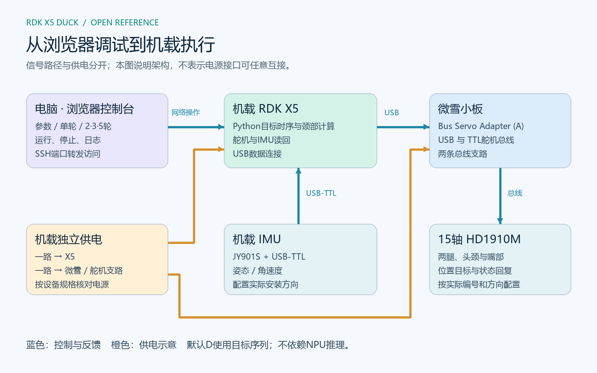

# RDK X5 Duck 完整开源方案发布：从打印装配到全机载短距离前进

**RDK X5、微雪舵机小板和电池全部安装到鸭子本体后，我们实现了短距离前进，并在本次展示结束时保持站立。** 现在，把支撑这一成果的结构改件、硬件连接、控制代码、可视化调试工具和研发经验集中开放，供社区复刻和继续改进。

本方案围绕现有RDK X5开发板展开。开发者可以从打印装配开始，也可以复用其中的串口控制、姿态采集、动作回放和调试界面，为自己的机器人搭建实验平台。

**项目仓库：[Xiaomiju-x/rdk-x5-microduck](https://github.com/Xiaomiju-x/rdk-x5-microduck)**  
**资料下载：[仓库ZIP](https://github.com/Xiaomiju-x/rdk-x5-microduck/archive/refs/heads/main.zip)**  
**社区交流：[地瓜社区项目主帖](https://forum.d-robotics.cc/t/topic/35728)**

## 1. 先看现在的鸭子

[▶ 全机载短距离前进与整机硬件展示](../media/20261023/onboard-short-walk.mp4)


这段10月23日实拍记录了从“桌面外接电控”到“机体携带计算、驱动和供电后能够前进”的突破。视频前段展示短距离前进，后段展示整机硬件，完整片长约13秒。

当前已完成：FT打印本体装配、15轴舵机联调、RDK X5控制链路、IMU数据接入、硬件机载集成，以及D短距离前进和颈部时序微调。长距离、多轮稳定性及完整实时RL行走继续推进，本次发布以这套已取得实机结果的短距离参考方案为基础。

## 2. 整套方案如何工作



**RDK X5是机载计算和控制主机。**它运行Python控制程序，读取IMU和舵机状态，按动作时间序列下发关节目标；通过USB连接微雪Bus Servo Adapter (A)，由小板连接飞特舵机总线。JY901S通过USB转TTL接入X5，提供姿态和角速度数据。

浏览器控制台用于选择轮数、调整颈部角度和时机、发起一轮动作、停止、检查和复位。公开包支持直接在X5运行，电脑通过SSH端口转发访问页面；动作执行在X5，电脑承担操作和观察。此次D默认动作不依赖NPU推理，也不需要先训练模型。

10月23日成功实拍中，X5在背侧竖装，两块蓝色电池分布于躯干两侧，微雪小板贴在其中一块电池外侧，前下方还能看到棕色附加安装/配重件。R8A支架提供X5与电池托位的结构参考，实物电池位置经过了现场调整，不能把早期CAD占位当作成功当天的完整质量分布。附加件质量及装载后总重未做完整记录。

两路电源分别供给计算板和舵机支路；电源电压、接口极性和带载能力按实际设备核对，USB数据连接不能替代舵机供电。

## 3. 开放资料清单

| 类别 | 本次提供 | 入口 |
|---|---|---|
| 硬件 | BOM、接口、供电与总线接线、15轴编号 | [硬件说明](../HARDWARE.md) |
| 结构 | FT上游本体来源、本项目轻量改件、可编辑模型/STEP/STL、TPU脚垫 | [机械文件](../mechanical/) |
| 装配 | 选定版本、打印要求、紧固件与装配顺序 | [装配说明](../ASSEMBLY.md) |
| 软件 | D相对目标序列、颈部时序、串口与IMU、单一控制台、配置模板 | [公开运行包](../software/) |
| 部署 | 电脑离线演示、X5安装、逐机START与首次动作流程 | [部署说明](../DEPLOYMENT.md) |
| 调试 | 冻结参数、日志、现场观察方法、失败案例 | [成功配置](../progress/2026-10-23/README.md) / [复盘](../PITFALLS.md) |

这里的完整方案覆盖选型、装配、部署、调试和资料获取。商品板卡由相应厂商提供，上游本体与本项目新增改件分别标明来源和许可。

## 4. 硬件采购与打印装配

核心组成是RDK X5、微雪Bus Servo Adapter (A)、15只飞特HD1910M总线舵机、JY901S及USB-TTL、两路独立供电、FT结构打印件和紧固件。详细规格、数量及接口见[BOM与接线](../HARDWARE.md)，选购时应核对实物尺寸和连接器，不能只按外观相似替换。

本体优先复用[机械行者Robo / fanhao375的FT CAD](https://github.com/fanhao375/microduck-replica-cad)。我们公开与机载布局相关的轻量安装件，以及脚底TPU脚垫的资料。结构件使用PLA，脚垫使用TPU 95A HF；脚垫的抓地效果仍会受到地面、装配和动作影响，材料替换不能替代步态调试。

推荐顺序是：**确认左右件和舵机方向 → 装配腿部及躯干 → 完成15轴编号检查 → 安装头颈 → 安装X5支架 → 按实物布局固定电池、小板和IMU → 整理线束 → 建立本机站姿。**

装配中请特别留意三点：一是螺母能否放入、工具能否进入，孔位对齐不等于可装配；二是支架与本体的承力连接，避免整个背包由薄小连接片承载；三是电源线与关节的活动空间，摆腿和颈部运动时都不能靠线缆拉住零件。当前下部支架已针对X5下孔螺母装入问题修正。[逐件说明与图解](../ASSEMBLY.md)


## 5. 先在电脑看懂控制台，再部署到X5

下载仓库后，在Python 3.10或更新环境中执行：

```sh
cd software
python -m pip install -r requirements.txt
python -m unittest discover -s tests -v
python runtime.py plan --cycles 5
python app.py --demo --port 9194
```

浏览器打开 `http://127.0.0.1:9194/`。DEMO无需机器人，便于了解参数、完整一轮的准备/动作/回位流程及停止行为。


真实部署时，将同一份软件复制到X5，核对实际关节编号与方向，再按配置模板填写自己的舵机串口、IMU串口、模式、offset和START。服务仅监听本机回环地址，电脑通过SSH隧道访问。完整命令与配置顺序见[部署文档](../DEPLOYMENT.md)。

**START是每台鸭子自己的站姿快照。**安装角、舵盘、offset和结构版本都可能不同；原型成功参数可以作为调试参考，原型绝对坐标不能直接当作新机标定。首次上机应先完成只读检查，托稳卸重后复位与检查动作，再由现场操作者确认落地效果。

## 6. D短动作与颈部配合：起步、走动、收步分开调

在多轮实机调试中，我们发现历史短动作仍可带来缓慢前移，随后围绕颈部配合迭代，最终取得全机载短距离结果。此次默认路线保留腿部目标片段，只调整11号颈根在不同阶段的位置和回位时机。


10月23日配置如下：

| 控制项 | 保存值 | 含义 |
|---|---:|---|
| 启动颈根角 | 0° | 相对本机START |
| 走动颈根角 | 前移30°，代码−30 | 走动段请求目标 |
| 起步保持 | 0秒 | 进入走动后开始过渡 |
| 角度过渡 | 0.2秒 | 平滑变化，不瞬间跳角 |
| 提前收颈 | 1.1秒 | 在原腿部收尾前开始平滑回颈 |
| 自动前/后倾反馈 | 0 / 0 | 本次成功配置采用定时配合 |

前移30°是请求值，舵机目标仍受每拍变化速率约束；提前回颈也会缩短维持前移的阶段。因此不能把参数直接解释为实物一定前倾了30°。提前量按原轨迹名义时间计算，串口耗时可能拉长实际用时。

现场微调时，先保持腿部动作和其他条件相同，每次只改一项：

- **起步前倒**：在确认本机方向后，小步调整启动角，使头颈在起步阶段适当后移。
- **走动后倒**：单独调整走动角，让头颈适当前移；不要因此把启动阶段也一起改掉。
- **最后收步前倒**：调整提前收颈，让颈部在腿部动作结束前逐步回位，而不是等动作完全停下才回。

这些是本原型的调试方法，效果需要结合实际负载、地面和关节跟随观察。控制台记录参数与执行状态，现场是否真正前移、是否需要接住由操作者补充。

## 7. 从一轮扩展到连续短段

公开控制台提供1、2、3、5轮。每轮保留完整400帧：150帧准备、100帧短动作、100帧平滑回位、50帧保持；重复的是完整单轮，不是截取中间动作直接硬循环。

每轮重新建立颈部时序与IMU参考；停止、通信/IMU异常或未完整结束时，不再进入下一轮。刷新后的默认选择仍为单轮，操作者自行确认现场状态后运行。

连续轮扩展已完成离线检查，尚待多轮实机验证。它为后续更长距离和真实步态研究提供过渡，当前不据此承诺距离或连续稳定性。本次公开便携包也经过独立离线核验；前述实拍是原运行版本的实机结果，打包版仍需复刻者按自身设备逐级验证。

## 8. 研发过程中的经验也一起开放

我们保留了[研发时间线](../BUILD_LOG.md)、[早期前倾/承重视频](../pitfall-loaded-tracking.mp4)和[动作切换失稳视频](../pitfall-policy-transition.mp4)。这些记录帮助后来者理解：

1. **同一目标不等于同一效果。**悬空能跟随，落地承重时可能出现明显差异，应把目标、实际位置、供电和负载放在一起看。
2. **供电支路和线束属于运动系统的一部分。**右腿独立接到小板支路后曾观察到改善，但单次改线并不能证明所有失稳都来自供电。
3. **结构重量和安装距离需要一起考虑。**背包离躯干较远会增加后坠力矩，后续布局逐步向贴身、上下分布和轻量化调整。
4. **起步与收步需要单独处理。**可前移的中段动作，加上合适的颈部过渡和提前回位，才形成这次完整展示。
5. **版本与现场条件要可追溯。**默认动作、实验策略、实际装载、参数和观察分别记录，避免把不同测试混成同一结论。

## 9. 下一步与社区共建

RDK X5 Duck继续作为主线，推进重复起停、连续短段、质量与执行器适配以及实时策略；V2与硬件同事协作，向X5 Module与专用底板的机内集成推进。陆吾XGO-Duck作为独立平台对照，南瓜鸭作为主题外观和互动探索，两条副线的成果分别记录。[后续路线](../ROADMAP.md)

在团队支持下，本项目由**CanNyCat（Xiaomiju-x）主导推进与实机集成**，覆盖选型、打印装配、控制链路、舵机/IMU联调、现场微调和开放资料整理。感谢Pollen Robotics、机械行者Robo / fanhao375及相关开源项目提供的机器人设计、CAD与算法生态。

本项目新增软件按Apache-2.0开放，FT衍生结构与媒体分别遵循其[许可说明](../NOTICE.md)。欢迎提交轻量改件、复刻记录、调试方法与代码改进；提问时附上结构版本、供电、参数、日志和实际现象，方便社区共同定位。

**从现有开发板出发，先把一套能够搭建、观察和继续改进的机器鸭方案交到开发者手里。**
