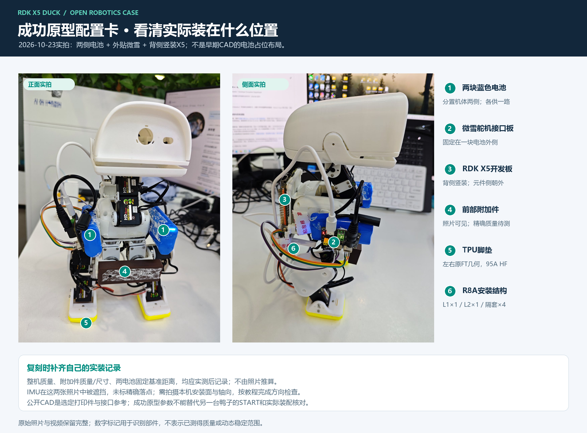

# 成功样机配置卡：把视频、结构和参数对齐

本卡对应 **2026-10-23 全机载短距离前进实拍**，用于解释“演示时机器到底装了什么”，也供复刻者建立自己的配置记录。它不把照片推算成未测量的质量、精确角度或性能指标。

> 这张配置卡继续保存10月23日双电池成功样机。10月27日单电池供电启动结果单独记录在[最新进度](../progress/2026-10-27/README.md)，R9实配和单电池带载验证尚待完成，不回写旧视频条件。

## 1. 成果与条件

| 项目 | 已有记录 |
|---|---|
| 硬件范围 | RDK X5完整开发板、微雪Bus Servo Adapter (A)、两块机载成品电池、HD1910M×15、JY901S、FT打印本体、R8A系列支架、黄色TPU脚底 |
| 实机结果 | 展示前段短距离前移，后段展示硬件，末段保持站立 |
| 视频含义 | 完整发布副本约13秒，包含行走和绕机展示；不是13秒持续步行 |
| 控制路线 | D历史目标片段＋11号颈根分段角与提前回位；成功参数的自动前/后倾反馈均为0 |
| 发布软件 | 便携D包来自原运行链路的提取，已做离线等价检查；视频不是本次重新部署公开包后的新实机验收 |
| 尚未形成的测量 | 精确距离、速度、连续稳定时长、当前完整整机重量、质心、棕色件质量与材料 |

完整视频：[全机载短距离前进与硬件展示](../media/20261023/onboard-short-walk.mp4)。软件与后续实验分别见[部署](../DEPLOYMENT.md)和[路线图](../ROADMAP.md)。

## 2. 正侧实拍：以成功当天为准

未标注原图：[正面](../media/20261023/onboard-front.jpg) / [侧面](../media/20261023/onboard-side.jpg)。下表编号与图中一致。

| 标记建议 | 可从资料确认的位置 | 不应从照片推断的内容 |
|---|---|---|
| 1 · 两块电池 | 蓝色成品电池分置躯干两侧，随本体运动 | 单凭外观认定哪块一定是某SKU、峰值电流或剩余电量 |
| 2 · 微雪小板 | 固定在其中一块电池外侧，USB及DC插头外露 | PCB与电池之间绝缘层厚度、胶面积、固定强度 |
| 3 · RDK X5 | 躯干背侧竖装，接口朝外，可接近USB及电源口 | 板卡精确质量、RAM档位、相对脚底的毫米坐标 |
| 4 · 前下方附加件 | 成功照片中可见棕色安装/配重件 | 材料、重量、是否实心、所有新机都需要同样配重 |
| 5 · TPU脚底 | 左右黄色足底，保留原硬脚掌和踝结构 | 摩擦系数、所有地面的抓地效果 |
| 6 · R8A支撑 | L1根座、L2支架与四个6mm隔套用于X5安装 | 由照片推断完整机械强度、载荷中心 |
| 未编号 · IMU | 使用固定在刚性躯干上的JY901S；具体安装依据本机配置记录 | 此组正侧照片有遮挡，不能用箭头虚构传感器精确落点或旋转矩阵 |

IMU安装可在复刻时单独拍一张看清板上轴向标记的近照。不要为了复刻一张照片而改成松动或跟随头颈运动的安装位置。

## 3. 本体与机载增量的对应关系

| 子系统 | 采用文件 / 配置 | 关系 |
|---|---|---|
| FT本体 | [28个选定硬件STL](../mechanical/body_parts/README.md) | 固定FT来源；包含面板/眼圈，排除轮滑与旧备选 |
| 躯干底部连接 | R8A L1×1 | 替换上游052底板，不叠装 |
| X5支撑 | R8A L2×1、6mm隔套×4 | X5四孔固定，下方螺母入口已修正 |
| 原下电池托位 | L2保留托指与绑带槽 | 是设计参考，成功照片电池已改到两侧，不在这里再装第三块 |
| 两侧电池/微雪 | 实拍固定方案，泡棉及辅助固定 | 没有另交付一套声称精确复现照片的侧电池CAD |
| 脚底 | 046左＋048右 | 原FT几何，TPU95A HF |

历史从重型后置背包逐步改为贴身安装，现R8A模型只包含选定打印实体。旧占位图、旧背包487g记录和10月22日胸前/下部布局均不是10月23日的完整装载测量。

## 4. 保存的动作参数

| 控制项 | 保存值 | 解释 |
|---|---:|---|
| `neck_mode` | `two_stage_pose` | 启动、走动和收步分阶段 |
| `bias_deg` | 0 | 启动相对本机START角 |
| `motion_deg` | −30 | 走动请求头颈前移30°；不是保证实际达到30° |
| `start_hold_s` | 0 | 进入动作后立即开始平滑过渡 |
| `transition_s` | 0.2 | 过渡时长设置 |
| `return_advance_s` | 1.1 | 提前开始回颈，沿原轨迹时间定义 |
| `gain` / `back_gain` | 0 / 0 | 成功记录未叠加自动前/后倾反馈 |
| 自动补偿上限 / 死区 | 4° / 1° | 增益为0时不因此产生自动补偿 |

原型动作方向是11号计数增加向后、减少向前。**新机先核方向和站姿，再使用参数作为起点**。绝对START、硬件offset不在另一台机器之间直接通用；捕获自己的参考姿态不会自动修正机械装错或不一致的关节方向。

## 5. 复刻者填写自己的配置卡

建议把下表填在自己的构建记录中，与视频、参数、配置和日志放在一起。未测项写“未测”，不要用仿真估值替代。

| 字段 | 本次填写 |
|---|---|
| 构建日期 / 软件Release / 结构版本 |  |
| X5型号、系统镜像、Python版本 |  |
| 舵机批次、固件、模式、ID方向确认记录 |  |
| 两路供电SKU、额定输出、线长、接口极性 |  |
| 整机总重（含本次所有附件） |  |
| X5、电池、微雪、附加件各自重量与安装位置 |  |
| 配重材料、重量、固定方式，是否能滑动 |  |
| IMU正面轴向近照、串口配置、安装矩阵 |  |
| 正面/侧面站姿照、脚底材料、测试地面 |  |
| START文件、颈部参数文件、轮数 |  |
| 实际结果：前移/原地、接护/未接护、起停表现 |  |

量位置时约定+X朝嘴巴、+Y朝鸭子左侧、+Z向上，选一个固定机身基准点并拍照标出。写清“相对哪个点测量”比只写“靠前一点”更利于别人复现。正常站稳、离线数据一致、短距前移和长期稳定是不同记录，分别填写。
