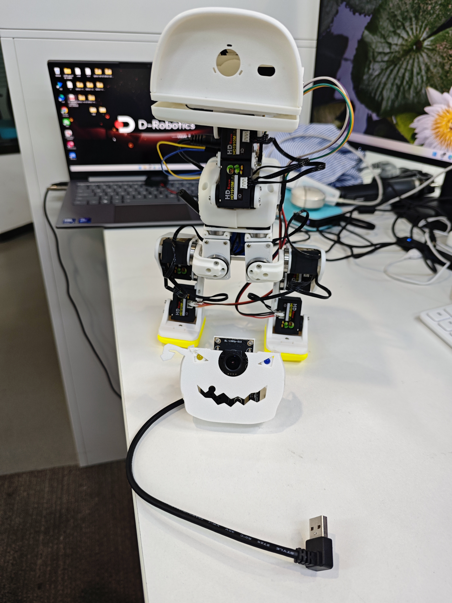
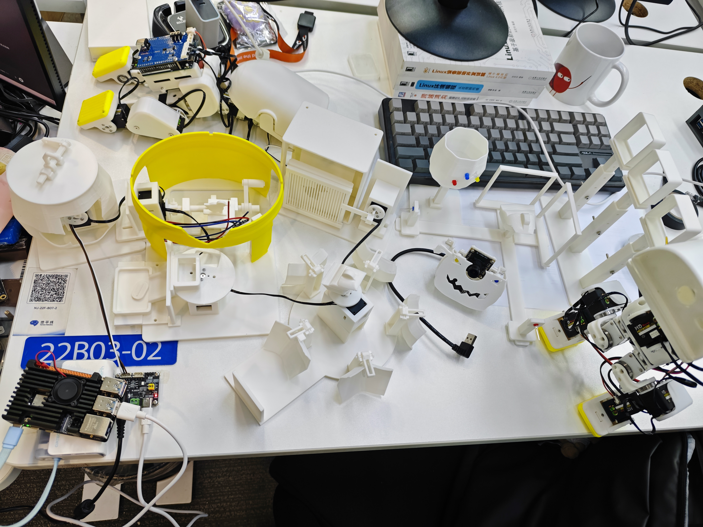

# Pumpkin Duck Garden

**Closed and archived on October 30, 2026. No further active development or integration is scheduled.**

[中文](README.md) · [Status and limits](STATUS.md) · [Unfinished extension ideas](EXTENSIONS.md) · [Assets](ASSET_INDEX.md)

Pumpkin Duck Garden is the Halloween appearance and interaction side project of RDK X5 Duck, led by Lingxuan Zhou (CanNyCat) with team support. It brings together a physical robotic duck, a white pumpkin mask, 3D-printed tabletop mechanisms, and Web / UE5 scenes. The project closes with the prototype and presentation materials that actually exist. Unfinished functions remain documented as optional ideas, with no delivery commitment. The main RDK Duck project continues separately.

## The pumpkin mask

The removable pumpkin attachment sits in front of the duck's torso; its original mechanical name is the pumpkin chest accessory. It gives the robot its Halloween identity and provides mounting space for the camera, LED eyes, audio openings, and a voice-module plate. It is separate from the computer/battery backpack.

The camera and audio hardware were installed. Visitor detection, voice-command software, expressive lighting, and coordinated head/beak responses were not completed as an integrated system. Loaded walking with the complete pumpkin configuration was not fully validated.

The archive includes a [selected STEP/STL snapshot](mechanical/mask/README.md), using the closed-hole front collar, revised camera bracket, and flat voice-module plate.

## The garden

The physical scene includes a blinking pumpkin, hatching platform, seed gate, central turning display, five-petal box, sliding grille, and display frames. Five desktop servos were assigned IDs 2 through 6 on a separate controller. The final handshake-leaf switch was dropped; one hatching switch remained.

Full physical coordination was unfinished. A drive-side / passive-horn mismatch and connector clearance problem in the original mounts remained unresolved. Servo telemetry reaching a target does not prove the attached mechanism moved. The central turning display was intended for limited-angle face switching, not endless rotation or automatic opening of all five petals.

## Digital scenes and evidence

The local Web and UE5 versions and their checks are retained separately. Physics-recorded motion is replayed in the games; character displacement remains game-controlled. This is not a qualified live physical policy or deployment to the robot. Passing a game story branch does not validate the equivalent physical switch, camera, or seed-transfer interaction.

The [October 23 short-walk video](../../media/20261023/onboard-short-walk.mp4) documents the earlier two-battery main robot. It is not a complete pumpkin-system demonstration. The later single-supply startup result is a separate milestone; see the main project's [latest power update](../../progress/2026-10-30/README.md).

Presentation files, the final Group 03 slide deck, bilingual speaking scripts, assembly revisions, local game packages, and training evidence remain in the local archive. This public folder contains selected documentation, real photographs, and mask geometry; it does not claim to contain every local deliverable.

The unfinished [mask and garden extension ideas](EXTENSIONS.md) are retained without an active development plan. No new robot configuration, printing, training, or physical movement is part of this closeout. The main repository remains active, and its existing fixed releases are unchanged.

Documentation: Apache-2.0. Photographs and FT-derived geometry: CC BY-NC-SA 4.0, with upstream attribution. See [NOTICE](NOTICE.md).
