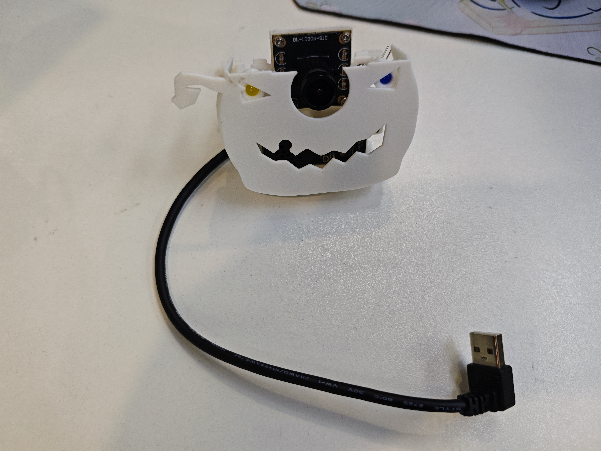

# 南瓜鸭 · Pumpkin Duck Garden

**项目状态：已结项归档 · 2026-10-30 · 不再主动开发或安排后续联调。**

[English](README.en.md) · [完成与未完成状态](STATUS.md) · [保留的功能拓展](EXTENSIONS.md) · [文件与来源](ASSET_INDEX.md)

南瓜鸭是 RDK X5 Duck 的万圣节外观与互动副线，由周苓萱（Lingxuan Zhou / CanNyCat）在团队支持下推进。作品把真实机器鸭、白色南瓜面具、3D 打印桌面瓜园和 Web / UE5 数字场景组合在一起，以现有原型和展示资料结项。**归档保留成果、问题和未完成设想；不表示所有原定功能已经实现。** RDK Duck 本体主线继续独立推进，见[主线当前进度](../../progress/2026-10-30/README.md)。

## 主角：机器鸭与南瓜面具

面具是安装在鸭子躯干前方的可拆南瓜外观组件，原机械名称为“南瓜精灵胸甲”。它让机器鸭成为有辨识度的万圣节角色，并为相机、灯眼、麦克风/出声口及语音模块托板预留位置。它不是用来承载主控和电池的背包。

| 面具的作用 | 结项时的实际状态 |
|---|---|
| 白色南瓜造型、外观与模块安装结构 | 有实物照片和打印结构快照 |
| 相机鼻子、灯眼、声音开口和可拆托板 | 已有结构；相机与语音硬件装上，未完成完整功能联调 |
| 发现访客、判断方向、回应口令、用灯和头嘴动作反馈 | 保留为未完成拓展，未实现成套视觉/语音互动 |
| 挂载面具及外设后的持续稳定行走 | 没有完整验收证据，不能由旧裸机/不同配置视频推定 |

[面具结构快照与版本选择](mechanical/mask/README.md)。保留闭合双孔前抱箍 R1c、相机排针让位 R1a、语音平托板 R1b；原半孔前抱箍、旧语音卡边和 P07 隔套不混入本次选件。

## 瓜园：围绕角色的桌面场景

已制作、打印和装配的场景包括眨眼南瓜、孵化升降、放籽转门、五瓣宝盒中央转台、幻影格栅和展示框等。桌面独立 X5 的五只舵机编号为 **2–6**，与机器鸭本体的十五轴系统分开。

| 桌面编号 | 对应机构 | 结项边界 |
|---|---|---|
| 2 | 眨眼南瓜头 | 机械装配和逐只编号有记录，完整装机动作未验收 |
| 3 | 孵化升降 | 平台、立柱、开关与轻薄装饰壳有实物；端点和开关闭环未验收 |
| 4 | 放籽转门 | 完整送籽/缺货反馈未在实物完成 |
| 5 | 五瓣宝盒中央钥匙转台 | 设计为有限角度换面再返回；不是持续自转，也不是自动开五瓣的轴 |
| 6 | 幻影格栅滑动 | 全行程与装机驱动联调未完成 |

现场曾出现软件反馈到位而外部机构没动的问题，后续发现装配使用从动盘，原托架又阻挡主动侧连接器插入路径。该机械适配问题没有修复验收；不能将其归为编号错误或已完成自动互动。最后一个握手叶片 KW11 已按实际取舍取消，仅保留孵化处的一只开关。[机械问题记录](MECHANICAL_NOTES.md)

## 数字展示与实物分开记录

Web 与 UE5 可玩场景、叙事路线、仿真动作数据和测试记录在本地保留。游戏中的等待、遮挡、缺货等分支通过，不等于相机、开关、舵机和实物种子的对应流程已经通过。

已有的物理录制动作以 `physics_rollout_replay` 接入数字场景，角色位置由游戏控制。它不是实物机器人实时策略部署或整套瓜园控制器。具体测试范围见[状态记录](STATUS.md)。

## 成果与使用入口

- **实物照片：** 本页均为实拍；[照片与文件清单](ASSET_INDEX.md)。
- **机器鸭历史运动基础：** [2026-10-23 原始短距离前进录像](../../media/20261023/onboard-short-walk.mp4)，属于当时双电池主线样机，不是南瓜整套联动录像。
- **结构研究：** [面具 STEP / STL 与选件说明](mechanical/mask/README.md)，按原型快照保留，不作为整套开箱即用制造包。
- **本地保留：** 中文/英文展示材料、Group 03 终稿、五版中英讲稿、装配修正图、21 盘制造历史、Web 工程、UE5 独立包和训练回执。它们没有全部重新上传到这个公开目录，见[归档范围](ASSET_INDEX.md)。
- **未完成拓展：** [面具感知与表达、瓜园事件与反馈](EXTENSIONS.md)，只保留设计，不安排开发日期。

## 结项说明

本副线停止新增设计、训练、打印和联调任务，原定夜间自动化已停止。现有文件保留供展示与研究；日后如有新的工作，应作为另行明确授权的独立项目。没有因为结项而修改主线运行参数、实体舵机配置或既有固定 Release。

本目录说明文字适用 Apache-2.0；实拍与 FT 接口衍生结构适用 CC BY-NC-SA 4.0，保留上游署名，见[来源与许可](NOTICE.md)。
